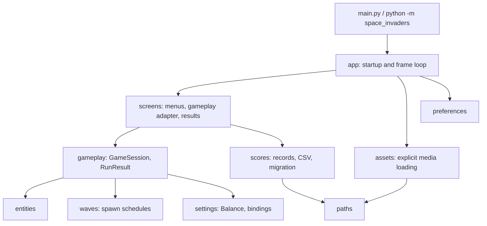

# Architecture

A small flat package with one application loop. No engine, ECS, event bus or plugin system.

| Module | Responsibility |
| --- | --- |
| `app.py` | Initializes display, fonts, optional audio, assets, data paths and preferences; runs the single frame loop; owns shutdown. |
| `screens.py` | Menu, instructions, gameplay adapter, pause, results/name entry, scores, settings. Each has `handle_events`, `update`, `draw` and returns a `Transition`. |
| `gameplay.py` | `GameSession.update_step` advances one 60 Hz tick: waves, spawning, input, pickups, combat, scoring, defeat. |
| `entities.py` | Positions, sprites/masks, movement and drawing. Shooters own their projectiles. |
| `waves.py` | Deterministic wave counts and spawn schedules from an explicit RNG. |
| `scores.py` | `ScoreRecord`, validated UTF-8 CSV, atomic writes, Top 10 ranking, legacy import. |
| `settings.py` | UI constants, the frozen `Balance` values, control bindings and the ruleset id. |
| `paths.py`, `assets.py`, `preferences.py` | Resource/data locations, media loading, user settings. |

## Invariants

- Importing any module performs no display, mixer, font, asset or file work.
- One `pygame.event.get` per frame; QUIT beats all other input; a transition discards the rest of the
  frame's events; update runs before draw.
- Gameplay advances in fixed 1/60 s steps, at most 15 per frame (0.25 s); stalls are dropped, not replayed.
  Pause and resume reset the accumulator.
- A projectile, pickup or enemy contact resolves exactly once; contact takes priority over a breach.
- A wave ends only when both visible enemies and pending spawns are empty; nothing heals or spawns after
  defeat. A run's `RunResult` is frozen at defeat.
- Presentation effects use their own RNG and never change simulation state.
- Score saves are atomic and idempotent per `run_id`; a failed save leaves the file unchanged. Unreadable
  score files are never overwritten. Legacy migration must succeed before the first save creates
  `scores.csv`.
- Results are grouped by mode and ruleset (`legacy`, `classic-v1`, `modern-step1..4`, `modern-v1`).
