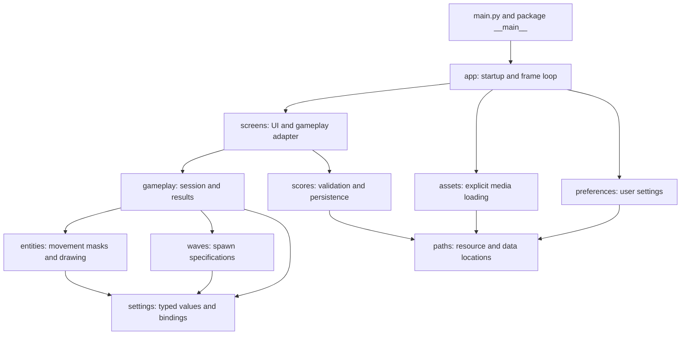
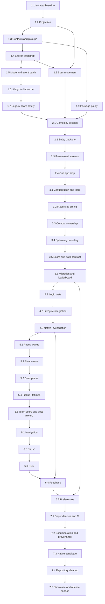

# Space Invaders — Authoritative Implementation Plan

Version: 1.1 · Prepared: 2026-09-19 · Status: planning complete; implementation not started.

v1.1 amendments (independent Codex plan review, round 1): legacy score decoding and atomic legacy rewrite in 1.7 (R1, R2); migration is a precondition of the first save (R3); non-UTF-8 legacy encoding is unconfirmed until an explicit override (R5, round 2); Phase 5 rollback only in reverse order or under a fresh ruleset ID (R4).

Baseline: `23aa512e7e2bb9bf21f7648888d184b463bcff5f` on `master`.
Repository: [udivak/Space-Invaders](https://github.com/udivak/Space-Invaders).
Tracking: [PROGRESS.md](PROGRESS.md).

This document is the implementation authority. PROGRESS records status and evidence, not a competing design. Task IDs are stable. Any approved change to a behavior contract must update this plan before dependent implementation. This planning task authorizes only these two documents: no production edits, dependency changes, builds, Git commits or publication have been performed.

## 1. Executive Implementation Strategy

Preserve the existing game through incremental, runnable changes. Fix unsafe collection handling and lifecycle defects first; extract corrected behavior second; add a small set of gameplay changes only after deterministic tests and session boundaries exist.

The implementation has seven phases and 37 bounded tasks. Each task has one objective, specified changes, dependencies, a behavior contract, validation and a suggested commit. No task is an engine rewrite. The baseline remains runnable through `python main.py`; `python -m space_invaders` is added in 2.4.

Three deliberate refinements to the audit roadmap:

1. **Two lifecycle steps.** Phase 1 makes existing screen loops return to an iterative dispatcher. Phase 2 introduces frame-level screens and the single outer event/render loop. This prevents a stabilization task becoming a full rewrite.
2. **Fixed-step timing.** Use a 60-Hz simulation accumulator, preserving per-tick heat/cooldown/randomness. Do not convert all logic to variable delta time or retune it during a refactor.
3. **Preserve actual pickup policy first.** The broken counter proves no working quota. Stabilization keeps one active package and continuous replacement; explicit effect redesign occurs only in 5.4.

Tests start in Task 1.1 and accompany every fix. Phase 4 expands confidence rather than postponing testing. Numeric gameplay values in Phase 5 are proposed starting values, not claims of established balance. Do not spawn sub-agents without current-task user approval. Phase gates are verification gates; an authorized multi-task implementation does not require redundant permission requests at each gate.

## 2. Verified Audit Findings

### Verification performed for this plan

Re-read main.py, Classes.py and test_Space_Invaders.py, relevant repository instructions, README, Dockerfile, requirements and ignore rules. Compared SHA-256 values of all 43 tracked files against the audit baseline: **no tracked file changed**. HEAD remains the audited commit. There was no existing docs directory. The pre-existing untracked AGENTS.md is outside this plan's edits.

The prior audit's 14 passing tests, controlled crash reproductions and headless startup evidence therefore still apply to this exact source. Those executions were **not repeated or represented as fresh native validation** in this planning step. Docker/native Windows/audio checks remain unverified. Current source findings use baseline line numbers, which will move during implementation.

### Confirmed defects and exact regression ownership

| Audit ID | Root cause/current behavior | Desired outcome and exact current location | Regression to add | Task | Balance effect |
| --- | --- | --- | --- | --- | --- |
| B1 | Ship.move_lasers checks P2 after consuming a P1 hit; second removal crashes | First collided player consumes the shot, shield or not; Classes.py:83–97 | One shot overlaps both players, with P1 shield on/off | 1.2 | Removes accidental double-hit/crash; stable P1 tie order |
| B2 | Pickup loop applies/removes the same item for two players | First eligible recipient, one removal; main.py:194–212 | Every package type at overlapping players; ineligible P1/eligible P2 | 1.3 | Defines one recipient in previously crashing cases |
| B3 | Enemy removed for contact can be removed again for P2 or invasion | One contact recipient; contact precedes exit; main.py:216–232 | Overlapping players and contact-plus-bottom-exit | 1.3 | Prevents double damage/breach in invalid cases |
| B4 | Consumed package is later removed by bottom check | Skip exit handling after consumption; main.py:197–214 | Pickup and exit in same step | 1.3 | No intended reward change |
| B5 | Removing from laser list while iterating skips neighbor | Every original shot advances once; Classes.py:83–97,145–164 | First removed, second moves; both shooter types | 1.2 | Restores intended projectile speed |
| B6 | Target loop continues after player shot is removed | Single-hit projectile stops at first valid target; Classes.py:152–164 | Three overlapping targets; one point/one removal | 1.2 | Removes accidental piercing and excess score |
| B7 | Solo menu branch never resets co-op flag | Explicit mode on each selection; main.py:375–382 | 2 -> 1 -> 2 selection sequence | 1.5 | Correct chosen mode |
| B8 | Classes imports main during main's wildcard import | One-way imports and explicit startup; Classes.py:7/main.py:4 | Both import orders in new processes; no resources initialized | 1.4 | None |
| B9 | Scores calls menu while earlier gameplay/screens remain suspended | Screens return outcomes; later a single frame loop; main.py:56–64,294–296 | 20 repeated complete cycles, bounded stack and released sessions | 1.6, 2.4 | None |
| B10 | QUIT calls pygame.quit then returns to a suspended renderer | Quit propagates to one shutdown owner; main.py:248–251,65 | Quit from name entry and every other state | 1.6 | None |
| B11 | package_counter resets each update | Remove fictitious quota; document actual one-active continuous policy; main.py:120–125 | Seven replacement cycles within one wave | 1.9 | None in stabilization |
| B12 | Boss.move replaces y with sine around zero, ignoring spawn y | Continuous sine around spawn baseline; Classes.py:209–218 | First-step bound and full cycle around legal spawn heights | 1.8 | Corrective position change; playtest |
| B13 | Boss at exactly 28 HP reaches zero without removal | Subtract then remove at <=0; Classes.py:154–159 | 28/27/400-HP cases; normal 400 requires 15 hits | 1.2 | Latent boundary fix; normal hit count unchanged |
| B14 | Asset paths use process CWD | Resolve relative to application resources; Classes.py:14–41 | Launch from temporary CWD and packaged layout | 1.4, 7.3 | None |
| B15 | Score test writes default file and accepts an already-present row | Temporary target; exact append assertions; test_Space_Invaders.py:76–83 | A no-op save fails; original score hash unchanged | 1.1, 1.7 | None |
| B16 | Score columns have no horizontal bound | All legacy rows reachable by paging; later bounded ranked view; main.py:278–284 | 0/14/15/80 rows; Top 10 later | 1.7, 3.6 | Presentation only |

### Corrections and qualifications carried into implementation

- The stock 400-HP boss already takes 15 hits. B13 is an exact-zero boundary error, not an extra-hit defect in every stock encounter.
- The two event.get calls are a fragile design, not proof that held-key movement currently loses input; movement uses key.get_pressed.
- The score file is displayed as raw lines. There is no current numeric parser to fix, no eval vulnerability, and no current sorted leaderboard to preserve.
- The counter does not establish whether the author intended two or three packages per wave; no quota will be inferred.
- Circular imports do not prevent the normal script from launching; they cause duplicate main module execution and break specific import order.
- Frame dependence, faster diagonal movement, disappearing enemy-owned bullets, shield contact limitations, boss zero reward and max-individual co-op scores are observable rules/design issues. They are not all confirmed bugs.
- requirements.txt is UTF-16 but pip successfully parsed it in the audit; convert for tooling clarity, not as a fabricated install fix.
- Ignored Windows environment/IDE files are not in the current tracked tree. Do not delete a user's ignored environment to clean Git.
- Name overflow, uncapped menus, blocking defeat sleep and swallowed exceptions are source-confirmed weaknesses addressed by lifecycle/persistence/UI tasks.

### Investigation tasks, not presumed fixes

Task 4.3 owns native audio saturation, actual CPU/frame behavior, co-op keyboard rollover and human difficulty/readability observations. Task 7.2 owns provenance/owner-license gaps; Task 7.3 owns executable/source parity and native Windows compatibility. Do not label untested failure modes as reproduced or change architecture merely because a risk is possible.

## 3. Target End State

A small flat Python package with one application loop; concrete screens; GameSession owning the simulation; a few entity classes; explicit assets, paths, tuning and score functions. Retain Pygame, pytest and standard-library persistence. No database, network service, ECS, event bus, DI container, generic scene framework, physics engine or user-editable balance-file system.

- **Startup:** both launch commands call app.run; import has no window, mixer, font, file or asset I/O.
- **Loop:** collect events once; quit globally; handle current-screen input; advance fixed-step gameplay; transition once; draw/present once.
- **State:** mode/session/result are explicit. No screen calls another loop. Pause retains a session; restart creates a new one.
- **Entities:** position, health, sprite/mask, movement and simple draw behavior. Session owns collision outcomes, score and wave rules. Shooter-owned projectiles remain until a separate approved redesign.
- **Rendering:** screen/HUD/effects consume state and feedback; never save scores or advance combat. Entity draw methods may remain.
- **Assets:** loaded once after initialization; paths work from source and bundled resource layout; audio is optional.
- **Configuration:** flat UI constants, typed control bindings and one small Balance dataclass. Preserve exact classic values until named gameplay tasks.
- **Persistence:** validated UTF-8 CSV under a writable user directory; atomic saves; original legacy file retained; distinct mode/ruleset leaderboards.
- **Tests:** deterministic logic with synthetic surfaces; small real-media/headless integration layer; recorded native playtest/build evidence.
- **Packaging:** native Windows x64 one-folder candidate with reproducible spec and required media. Additional native platforms only after separately validated builds.
- **Polish:** readable menus/HUD, keyboard navigation, pause, concise feedback, small preferences and honest portfolio media.

Final structure is shown after Phase 7. Assets remain at root throughout migration so moving Python modules cannot silently break media paths.

## 4. Architecture Principles

### 4.1 Behavior contract through Phases 1–4

Unless a task names a corrective exception, preserve:

| Rule | Classic contract |
| --- | --- |
| Viewport | 950x750; existing sprite sizes; no resizing |
| Controls | Solo arrows/Space; co-op blue arrows/L and orange WASD/G |
| Movement | 7.4 px/tick per pressed axis; diagonal remains faster; existing edge margins |
| Lasers | 10.5 px/tick vertically; player shots upward; triple side slope 0.4; y-only off-screen policy |
| Ship shooting | 17-tick cooldown; normal/triple heat +0.45/+0.35 per held-fire update; release cooling 0.6/tick; no cooling while held at full |
| Health | 100; bullets 10; ordinary contact 15; boss contact fatal; no friendly fire |
| Defeat | Five shared breaches initially; either player dead or breaches <=0 ends session |
| Recovery | Wave transition adds up to 20 HP, caps at 100; restores one breach up to five after first wave |
| Waves | Solo 10+2L; co-op 10+5L ordinary enemies; random red/green/blue; all straight before 5.2 |
| Boss | 400 HP in gameplay; 28 damage/hit; levels 3,5,7...; stabilized vertical baseline; old x wrap retained |
| Scores | Ordinary projectile kill=1; contact=0; boss=0; saved co-op score=max individuals before 5.5 |
| Packages | One active; replace next tick after consumption/exit; current random types/ranges; full-health HP stays unconsumed |
| Effects | Triple/shield reset on next wave until 5.4; shield only blocks enemy/boss projectiles |
| Projectile lifetime | Removing shooter removes its active shots; no global shot pool |

Approved corrective differences: consumed objects resolve once; dead bosses removed at zero; no post-defeat healing/spawning; explicit selected mode; continuous boss vertical motion; heat clamped to logical bounds in 3.1. Record each as correctness work, not hidden refactoring.

### 4.2 Configuration placement

| Values | Owner and initial values | Change boundary |
| --- | --- | --- |
| Resolution/render cap/simulation rate | settings.py constants: 950,750; render target 60; SIM_HZ=60 | No resolution change in this plan |
| UI colors/font sizes | Named constants in settings.py, consumed by screens/draw code | Phase 6 presentation only |
| Control mappings | Small immutable ControlBindings | Consolidate 3.1; no remapping UI |
| Player speed, health, cooldown, heat | Balance: 7.4 px/tick,100 HP,17 ticks,88 capacity,0.45/0.35 heat,0.6 cooling | Preserve except heat clamp; heat redesign deferred |
| Projectile/enemy/package speed | Balance:10.5/1/1.4 px/tick | Preserve until dedicated tuning task |
| Damage | Balance:10 bullet,15 contact,28 versus boss | Preserve |
| Wave counts | Balance base10, solo increment2, co-op increment5 | Preserve throughout selected scope |
| Enemy shooting | 1/70 attempt each 60-Hz simulation tick | Preserve ordinary enemy behavior |
| Boss movement/spawn/HP | 400 HP; odd levels >=3; speed1.75, amplitude100, phase step0.0525 | Position fix1.8; attack pattern5.3 |
| Spawning | Classic x=50..849,y=-1500..-101; package x=50..849,y=-500..-101 | Wave arrival5.1; package policy remains one-active |
| Points | Ordinary1,boss0 then boss10 in5.5 | Scoring task only |
| Powerup lifetime | Wave-scoped then triple720 ticks/shield3 charges | Task5.4 only |
| User preferences | preferences.py JSON schema: music volume, effects volume, reduced effects | Separate from balance; Phase6 |

Use explicit units in names. Do not scatter half-converted seconds/ticks. The Balance dataclass is a value object with defaults, not a service or a dynamic config loader. Tests can construct a variant without editing global constants. Runtime uses one agreed configuration.

### 4.3 Score and path contract

**Resource root:** determine relative to the installed package's __file__, with root assets/ and sounds/ mirrored in the frozen bundle. It is read-only application data. paths.resource_root() replaces assets.py's initial helper in 3.5. No os.chdir startup workaround.

**Writable data root:** SPACE_INVADERS_DATA_DIR, if set, must be a nonempty absolute directory path (invalid override produces an actionable error). Otherwise use Windows LOCALAPPDATA/SpaceInvaders, macOS ~/Library/Application Support/SpaceInvaders, or Linux XDG_DATA_HOME/space-invaders with ~/.local/share fallback. For absent Windows LOCALAPPDATA use ~/AppData/Local/SpaceInvaders. Create directories only at explicit load/migration/save startup, never at import. Scores and preferences never live inside the frozen resource bundle. Tests always override the destination.

**ScoreRecord:** run_id (nonempty unique string), name, score (integer >=0), mode (solo/coop/legacy), level (positive integer or unknown for legacy), ruleset (classic-v1, modern-step1 through modern-step4, modern-v1 or legacy for this plan). Validate ruleset IDs as 1..32 lowercase ASCII letters/digits/hyphens so readable future revisions remain separate rather than being discarded. CSV header order is exactly `run_id,name,score,mode,level,ruleset`. A run gets its ID once at session creation using uuid4; retries reuse it. New names are stripped, control characters removed, capped at 24 Unicode code points, blank becomes Anonymous. Legacy names/data are preserved during migration, and long labels are shortened only for display.

**Ranking:** filter by mode AND ruleset; descending score, then descending level with unknown below known, then original file order. Show Top 10. Retain all valid rows in storage. Legacy view is separate and does not pretend the old max-individual score is a team total.

**Reading:** missing means empty. Decode UTF-8, validate header/fields/types and collect row-number warnings for invalid rows. CSV structural/encoding/I/O failure is an explicit error, not an empty leaderboard. Do not evaluate legacy text. Parse legacy `(name, score)` using outer-parenthesis checks plus rsplit(',',1), so commas in names survive.

**Writing:** load/validate the existing file; create a temporary file in the same directory using UTF-8 and newline="" for csv; write header/all valid records plus new run if not already present; flush, fsync the file, then os.replace. Clean a leftover temporary on failure and preserve the destination. A normal successful retry with the same run_id is a no-op, not another entry. Report errors to the screen; Retry reuses pending data, Continue does not claim the score was saved. Scope is a single running game writer; no lock service or multi-process concurrency guarantee.

**Malformed data:** individual invalid CSV rows may be excluded from the display with a warning. Before a successful rewrite that omits any invalid row, create a unique timestamped byte-for-byte backup of the original using exclusive creation. If backup fails, abort save. A structural/encoding failure that prevents reliable parsing must not be overwritten: show recovery path and allow Continue without saving. Do not silently turn corruption into a blank new file.

**Migration:** if destination scores.csv does not exist in source mode, parse the known repository-root scores.txt (using the Task 1.7 legacy decoding rules: an unconfirmed non-UTF-8 source is not imported and migration stays unresolved until the encoding override confirms it), write valid records atomically to legacy/legacy, and retain the source unchanged. Report skipped lines; the retained source is their recovery copy. Existing CSV always wins, preventing repeat imports. A failed migration does not create a completion marker. **Migration is a precondition of the first save:** while migration is unresolved (source mode, legacy file present, destination absent), a normal score save first performs the migration and writes the new record into the same atomic write; if migration fails, the save fails with Retry/Continue and the destination is not created. Play remains possible without saving. Therefore a destination can only come into existence with migrated history already in it (or when no legacy source exists). In frozen mode no repository sample scores are bundled or auto-imported. Document manual import/recovery for a user's separately retained old file; do not scan CWD or arbitrary folders. Runtime files are not removed by repository cleanup.

### 4.4 Dependency direction and ownership



No arrow leads back to app or main. Entities may import the AssetBundle type, but the loader never imports entities. scores.py accepts ScoreRecord and does not import GameSession; the screen converts RunResult to a record. New frames never re-read media. Presentation feedback is a bounded, consumed value list, not infrastructure.

## 5. Phase Overview

| Phase | Outcome | Tasks | Gate |
| --- | --- | ---: | --- |
| 1 Stabilization | Correct operations and safe lifecycle, still using small legacy loops | 9 | Reproduced failures protected, imports/data safe |
| 2 Structural refactor | Session/screens/package and one application loop | 4 | Runnable entry points, one event owner |
| 3 Core systems | Explicit timing, controls, combat, spawn and score contracts | 6 | Classic behavior characterized and persistence safe |
| 4 Testing & reliability | Deterministic coverage and honest native observations | 3 | Automated integration green, limitations recorded |
| 5 Gameplay | Five selected changes with independent rollback | 5 | Tests plus short solo/co-op acceptance |
| 6 UI/UX/feel | Navigation, pause, HUD, bounded feedback, preferences | 5 | Rules understandable and simulation unchanged by effects |
| 7 Packaging/portfolio | Fresh installs, CI, docs, native build and honest showcase | 5 | Reproducible candidate; publication separately authorized |

The exact order is in Section 19. Dependencies are minimum technical dependencies, not permission to skip earlier phase gates. S/M are focused-task effort estimates, not promises of hours. If a task cannot fit one focused session, propose smaller sub-IDs before expanding scope. No XL task is accepted by this plan.

## 6. Detailed Phase 1 — Stabilization

**Goal:** Remove confirmed crashes, unsafe lifecycle behavior, import side effects and test/data hazards before structural cleanup.

**Why now:** All later changes depend on a reliable baseline. Introduce assets.py early only because explicit bootstrap is required to remove import-time failures.

**Files to modify:** main.py, Classes.py, test_Space_Invaders.py; test helpers as introduced.

**Files to create:** space_invaders/__init__.py, space_invaders/assets.py; conftest.py; focused tests under tests/.

**Delete/deprecate:** Only obsolete code/counters described in tasks; the root score test moves, but the remaining root test file stays.

**Remain untouched:** Asset/sound contents, executable, requirements, Dockerfile, README, original scores.txt data, AGENTS.md and ignored environments.

**Phase behavior contract:** 950x750; existing controls; fixed per-update values; one-point ordinary kills; no boss bonus; max-individual co-op result; odd-level bosses from 3; wave-scoped upgrades. Only explicitly listed defect corrections change outcomes.

### Task 1.1 — Isolate the existing test baseline

**Objective and reasoning:** Make baseline validation safe before modifying game behavior.

**Affected files/classes:** test_Space_Invaders.py; new root conftest.py; new tests/test_persistence.py.

**Exact implementation:** Set dummy SDL video/audio drivers in conftest before test collection imports game modules. Move the score test into tests/test_persistence.py; use pytest tmp_path and monkeypatch.chdir only around the score call, after current import-time assets have loaded. Assert the complete new file content and two distinct appends, not substring membership in a pre-existing file. Record the original score-file hash and verify it is unchanged. Keep the other 13 tests initially; record their limitations rather than treating them as proof of gameplay.

**Dependencies:** None. **Priority:** P0. **Effort:** S. **Risk:** Low.

**Expected behavior:** All original assertions still pass, with score writes confined to a temporary directory. A no-op save_score must fail the replacement score test.

**Preserve / intentional differences:** No production behavior, import order, asset, timing, or score-format changes.

**Validation:** Run T0 in a disposable copy first, then T1 in the working checkout; compare scores.txt hashes before/after. Add the no-op writer negative check.

**Commit boundary:** `test: isolate score persistence from application data`.

### Task 1.2 — Resolve projectile consumption exactly once

**Objective and reasoning:** Fix B1, B5, B6 and the B13 health boundary at their shared projectile paths.

**Affected files/classes:** Classes.py: Ship.move_lasers, Player.move_lasers; new tests/test_projectiles.py.

**Exact implementation:** Iterate a snapshot of each shooter laser list. Move each original laser once. If off-screen, remove once and continue. For enemy lasers, check players in existing P1/P2 order; the first collision consumes the projectile even if a shield blocks damage, then break. For player lasers, iterate a snapshot of enemies and consume/break on the first overlapping target still present. Keep ordinary kills at one point. For bosses subtract 28, clamp at zero, and remove/play the existing explosion once when health <= 0. Do not catch list.remove errors as a substitute for correct ownership.

**Dependencies:** 1.1. **Priority:** P0. **Effort:** M. **Risk:** Medium.

**Expected behavior:** Adjacent lasers advance every step; one laser resolves one target; overlapping players cannot trigger double removal; bosses die on the lethal hit.

**Preserve / intentional differences:** Keep projectile speed, vertical-only off-screen policy, target-list ordering, 10 bullet damage, shooter ownership, and 17-step cooldown. Bug correction removes accidental piercing; that can reduce accidental scores.

**Validation:** Cover off-screen-first/adjacent-live lasers for both owners; collision-first/adjacent-live lasers; overlapping P1/P2 with and without shields; three overlapping enemies; several lasers on one target; bosses at 28, 27 and 400 HP. Assert the 400-HP boss requires 15 hits and currently awards zero points. Run T1.

**Commit boundary:** `fix: consume projectiles once and resolve lethal damage`.

### Task 1.3 — Resolve pickups and enemy contacts exactly once

**Objective and reasoning:** Fix B2-B4 without adding new protection or reward rules.

**Affected files/classes:** main.py: package/contact loops; new tests/test_contacts.py and tests/test_powerups.py.

**Exact implementation:** Extract the existing contact and pickup blocks into small module-level helpers callable with players/objects and returning removal/breach/defeat outcomes. Keep list mutation with the caller. Move a package once; choose the first overlapping eligible player in stable P1/P2 order; apply one effect; consume once. Ineligible players do not prevent a later eligible player collecting it. A consumed package is not subsequently checked for exit. For ordinary enemy contact, damage the first overlapping player by 15 and consume the enemy; do not also count invasion. If no contact, crossing the bottom costs one invasion. Boss contact marks defeat and is not an ordinary-enemy removal.

**Dependencies:** 1.2. **Priority:** P0. **Effort:** M. **Risk:** Medium.

**Expected behavior:** Co-op overlap and pickup/contact at the bottom boundary are safe. An object cannot produce both a collection/contact outcome and an exit outcome.

**Preserve / intentional differences:** Shield blocks bullets only; boss contact is fatal; full-health HP packages remain unconsumed; upgrades remain wave-scoped; no invulnerability frames or friendly fire.

**Validation:** Regression cases for the four reproduced double-removal paths, all three package types, P1 ineligible/P2 eligible, shielded contact, boss contact, and ordinary exit without contact. Assert contact priority over invasion and no score for ramming. Run T1.

**Commit boundary:** `fix: make contact and pickup outcomes mutually exclusive`.

### Task 1.4 — Break the import cycle and make bootstrap explicit

**Objective and reasoning:** Fix B8/B14 and remove display, font, audio and asset side effects from imports.

**Affected files/classes:** main.py; Classes.py; new space_invaders/__init__.py and space_invaders/assets.py; conftest.py, new tests/test_startup.py and affected entity tests.

**Exact implementation:** Remove Classes.py importing main. Replace wildcard imports with explicit module references. Introduce AssetBundle and load_assets(resource_root, audio_enabled) in assets.py; importing it performs no I/O. Keep image-key maps as strings, resolve surfaces inside constructors, and pass assets explicitly to Player/Enemy/Boss/Package; Laser already receives its image. The bundle provides named images and optional sounds, with a small play helper that does nothing when a sound is unavailable. In main.run(), initialize display/font, attempt mixer initialization with a narrow pygame.error handler, then load assets and create fonts. Missing required images raise an informative startup error naming the path; missing audio or an unavailable device disables that audio and reports once. Resolve the asset root from assets.py location, never CWD. Existing screen globals may be assigned only inside run as a temporary bridge until 2.4; entity constructors must not read them. Update tests to construct a tiny explicit asset fixture.

**Dependencies:** 1.3. **Priority:** P0. **Effort:** M. **Risk:** Medium.

**Expected behavior:** Both import orders work in fresh subprocesses without opening a window or starting the mixer. Launch from another directory works. The game can run silently.

**Preserve / intentional differences:** Keep every existing media file, dimensions, colors, controls, sound levels when audio works, and gameplay values. Do not rename assets here.

**Validation:** Subprocess-import main and Classes in both orders and assert display/mixer remain uninitialized. Test resource resolution from tmp_path, missing required image, disabled/missing audio, actual asset loading under dummy drivers, and both-player startup. Run T1 and M1.

**Commit boundary:** `fix: initialize pygame and assets only at application startup`.

### Task 1.5 — Reset mode and drain events once per active screen frame

**Objective and reasoning:** Fix B7 and remove the second gameplay event consumer before lifecycle work.

**Affected files/classes:** main.py: main_menu, main, instruction event handling; new tests/test_lifecycle.py.

**Exact implementation:** Assign False on solo selection and True on co-op selection. Remove the secondary pygame.event.get block in main. Each still-existing screen loop retrieves its event batch once and processes that batch. Use event.pos for menu clicks instead of a later mouse-position sample. Make QUIT take precedence over further event handling in that frame.

**Dependencies:** 1.4. **Priority:** P1. **Effort:** S. **Risk:** Low.

**Expected behavior:** A 2-player run followed by solo creates one player with solo instructions. A queued click is handled at its recorded position.

**Preserve / intentional differences:** Keep existing key bindings and click targets. Complete application-wide single-loop ownership is intentionally deferred to 2.4.

**Validation:** Dispatch selections 2 -> 1 -> 2, checking instructions and constructed player count. Spy on event.get for one bounded gameplay iteration. Test mixed QUIT/click batches and held movement/fire controls. Run T1.

**Commit boundary:** `fix: reset player mode and consume each event batch once`.

### Task 1.6 — Unwind screens through one lifecycle dispatcher

**Objective and reasoning:** Fix B9/B10, stop updates after defeat, and keep every screen responsive.

**Affected files/classes:** main.py: run, main, redraw_window, main_menu, instructions_screen, game_over, display_scores; tests/test_lifecycle.py.

**Exact implementation:** Use main.run as an iterative dispatcher. main_menu returns mode 1/2 or None to quit; instructions_screen returns proceed/quit; main(mode) returns a frozen RunResult or None; game_over(result) returns a name or None; display_scores returns menu/quit. Screen functions must never call another screen. Use a small RunResult dataclass in main initially, containing run_id, mode, level, individual scores and defeat_reason (health, breaches or boss_contact); derive the current saved score as solo score or max co-op score. Remove the mutable global mode once parameters are wired. redraw_window only draws. Replace sleep with a 1.5-second ending state inside the gameplay loop that still drains events and renders. Freeze simulation once defeat is established; check defeat before new-wave recovery and after each completed update. Cap all current loops at 60. Only run finally calls pygame.quit. Remove broad error suppression; route expected persistence errors through 1.7 and log unexpected errors.

**Dependencies:** 1.5. **Priority:** P0. **Effort:** M. **Risk:** Medium.

**Expected behavior:** Restart cycles return to the same dispatcher stack depth; defeated sessions cannot heal/spawn another wave; quit exits without rendering after shutdown.

**Preserve / intentional differences:** Keep the 1.5-second visible game-over interval, entry/name/score sequence, boss schedule, wave healing, shared defeat and max-individual co-op saved score.

**Validation:** Drive at least 20 menu/game/results/menu cycles with scripted events, asserting stable call depth and collectible old sessions. QUIT from every screen including the 1.5-second ending interval. Assert no update or score change after defeat, and death wins over simultaneous wave completion. Run T1 and M1.

**Commit boundary:** `fix: return screen outcomes to a single lifecycle dispatcher`.

### Task 1.7 — Make legacy score I/O explicit and bound the score view

**Objective and reasoning:** Fix B15/B16 and surface filesystem failures without changing score semantics.

**Affected files/classes:** main.py: save_score, display_scores, game_over and dispatcher; tests/test_persistence.py; tests/test_lifecycle.py.

**Exact implementation:** Accept an explicit path for legacy read/write helpers, defaulting temporarily to scores.txt beside root main.py rather than CWD. Use context managers. Missing file means an empty score list that still offers return-to-menu. **Legacy decoding:** read bytes and decode as UTF-8. A file that is not valid UTF-8 has an *unconfirmed* encoding (the original writer used the platform default, which may be cp1252, cp1251 or another code page); never guess one automatically. Such a file is shown display-only, decoded with latin-1 purely for display, under a visible notice that names may display incorrectly and saving is disabled until the encoding is confirmed; navigation and play continue, and a save offers only Continue without saving. The documented recovery override is the environment variable SPACE_INVADERS_LEGACY_ENCODING (a Python codec name); when set and the bytes decode strictly with it, the file is treated as confirmed. **Legacy writing is an atomic rewrite, never an append:** read existing bytes, write the decoded existing lines plus the new `(name, score)` line as UTF-8 to a temporary file in the same directory, flush, fsync, then os.replace. If the existing file was confirmed via the override (not UTF-8), first create a unique timestamped byte-for-byte backup with exclusive creation (abort the save if the backup fails), so re-encoding never loses original bytes and the file is never mixed-encoding. Remove a leftover temporary on failure; the destination is untouched until replace succeeds. Keep raw legacy lines in file order. Display 14 rows on one page, with previous/next controls and a visible page count, so every record is reachable. Do not introduce ranking yet. Save once after name submission, with a dispatcher-owned saved flag set only after os.replace succeeds; on OSError retain the pending result/name and show Retry or Continue without saving. Because a failed attempt never alters the destination, Retry cannot duplicate or corrupt a record. Remove exception swallowing around screen calls.

**Dependencies:** 1.6. **Priority:** P1. **Effort:** M. **Risk:** Low.

**Expected behavior:** Empty/missing/unwritable files do not break navigation. Eighty records remain accessible through paging. Retrying a failed write does not double-submit after success.

**Preserve / intentional differences:** Keep the (name, score) record format, insertion order and score values until 3.5/3.6. Do not migrate or delete user files here.

**Validation:** Temporary-path tests for missing/empty files, Unicode, exact appended content, an existing non-UTF-8 file (cp1251 `Иван` and cp1252 `José`): without override it is display-only with the notice and a save is refused leaving bytes unchanged; with the matching override the name decodes correctly, the original is backed up byte-for-byte and rewritten as UTF-8; a wrong override that fails strict decoding stays unconfirmed, failure after a partial temporary write followed by a successful Retry (exactly one new record, destination unchanged after the failure), read/write/replace OSError and retry transitions. Test 0, 14, 15 and 80 rows with all pages bounded to the display. Run T1; manually submit one name to a scratch score path and return to menu.

**Commit boundary:** `fix: handle score file failures and paginate legacy records`.

### Task 1.8 — Make boss vertical movement continuous from spawn

**Objective and reasoning:** Fix B12 without mixing in a new encounter design.

**Affected files/classes:** Classes.py: Boss.__init__, Boss.move; test_Space_Invaders.py boss test; new tests/test_boss.py.

**Exact implementation:** Keep the sampled spawn y as the vertical baseline. Add a boss-local phase starting at zero, increment it by 1.75 * 0.03 per update, and set y = spawn_y + 100 * sin(phase). Keep x advancing 1.75 and the existing x>WIDTH wrap to zero; do not reset the vertical phase on wrap. Remove the ineffective y+=20 wrap adjustment and impossible downward-wrap branch for valid gameplay spawns. Replace the formula-mirroring old test with continuity and baseline tests.

**Dependencies:** 1.2, 1.4. **Priority:** P1. **Effort:** S. **Risk:** Medium.

**Expected behavior:** A boss spawned at y=250 moves a few pixels on its first step instead of jumping above the screen. Legal current spawn heights keep its vertical movement on screen.

**Preserve / intentional differences:** Keep 400 HP when spawned by gameplay, 28 damage per hit, existing x wrap, ordinary/boss firing rules, contact lethality and zero boss score. Removing the vertical jump is an intentional corrective positioning change with balance risk.

**Validation:** Check first-step displacement <= 100*0.0525, a full-cycle range centered on spawn y, repeated x wraps without vertical teleport, spawn heights 100 and 299, and unchanged horizontal speed. Run T1; visually inspect level 3 in a controlled session.

**Commit boundary:** `fix: anchor boss oscillation to its spawn height`.

### Task 1.9 — Remove the ineffective package quota without inventing one

**Objective and reasoning:** Resolve B11 as misleading state while preserving the actual shipping spawn policy.

**Affected files/classes:** main.py: package spawning and wave reset; Classes.py: unused package counters; tests/test_powerups.py.

**Exact implementation:** Remove package_counter and its increments/decrements. State and test the actual rule: at most one active falling package; when it is consumed/exits, a replacement is created on the next simulation update. Keep type choice and spawn ranges. Remove unused pack_duration/triple_shot_counter fields and the commented two-level duration block only after confirming no live callers.

**Dependencies:** 1.3. **Priority:** P1. **Effort:** S. **Risk:** Low.

**Expected behavior:** Repeated packages can appear during one long wave, deliberately and without a false quota. A newly spawned package is not created in the same update as consumption.

**Preserve / intentional differences:** No two-package or three-package quota is inferred from the broken counter. Shield/triple effects still reset on wave change until 5.4.

**Validation:** Seven successive exits in one wave yield seven replacements; never more than one active package; collection eligibility and next-wave flag resets remain unchanged. Run T1.

**Commit boundary:** `refactor: make continuous package replacement explicit`.

**Tests added/updated/unchanged and commands:** Add projectile/contact/pickup/lifecycle/import/path/score regressions. Update the score and boss-movement tests and constructor fixtures. Preserve all other existing behavioral assertions. Run T1 after each fix, T2 when its tests exist, and M1 at the phase gate.

**Manual checks:** M1 for affected gameplay/navigation; M2 after 2.4; Phase 4/6 require actual native feel/audio observations; Phase 7 additionally requires B1. Tests that cannot run are pending with a reason, not passed.

**Definition of done:** All B1-B16 have either their Phase 1 correction or a documented preserved policy; no double-removal failures; no nested restart chain; quit works from all screens; both import orders are inert; no production score writes from tests; temporary silent startup works. Score-format modernization remains scheduled for 3.5/3.6.

**Intermediate architecture after this phase:**

```text
main.py                         # bounded screen loops returning to run()
Classes.py                      # entities; no startup side effects
space_invaders/
    __init__.py
    assets.py                   # explicit resource loading
conftest.py
test_Space_Invaders.py           # remaining baseline tests
tests/                          # targeted regressions
assets/  sounds/                # unchanged media
docs/IMPLEMENTATION_PLAN.md
docs/PROGRESS.md
```

## 7. Detailed Phase 2 — Structural Refactor

**Goal:** Introduce explicit session and screen ownership, then replace the transitional dispatcher with one application frame loop.

**Why now:** Phase 1 supplies regression protection; splitting corrected behavior now avoids duplicating old bugs in a new structure.

**Files to modify:** main.py, Classes.py, existing tests and space_invaders/assets.py only for import wiring.

**Files to create:** space_invaders/gameplay.py, entities.py, screens.py, app.py, __main__.py.

**Delete/deprecate:** Classes.py after all callers move; temporary main.py screen functions/loops/globals after 2.4.

**Remain untouched:** Media, score contents/format, balance values, requirements, README, Dockerfile and executable.

**Phase behavior contract:** Every Phase 1 stabilized gameplay rule. Entities still own their shots; removing an enemy still removes its shots. Only screen ownership and update-before-draw presentation change.

### Task 2.1 — Extract a gameplay session with update and draw boundaries

**Objective and reasoning:** Move session ownership out of the screen function while keeping the stabilized game runnable.

**Affected files/classes:** main.py; new space_invaders/gameplay.py; tests/test_lifecycle.py and new tests/test_gameplay.py.

**Exact implementation:** Introduce GameSession(mode, assets, rng) owning players, enemies, packages, level, invasions and defeat. Move RunResult here and freeze it once at session end. Move the existing per-update logic into update_step(actions), with no event.get, Clock, display.update, score I/O or screen calls. Keep draw(surface) separate. Pass random.Random-compatible RNG; runtime uses an unseeded instance, tests use seeded/scripted instances. Move the small contact helpers from 1.3 with their callers. The existing main gameplay loop constructs the session and delegates; do not change the top-level dispatcher yet.

**Dependencies:** 1.6, 1.7, 1.8, 1.9. **Priority:** P1. **Effort:** M. **Risk:** Medium.

**Expected behavior:** A test can advance gameplay without opening a screen loop. The current launch command and all stabilized screens still work.

**Preserve / intentional differences:** Preserve the stabilized update ordering and all behavior-contract values; draw remains independent even if the legacy loop still draws before update.

**Validation:** Compare seeded state at selected update counts before/after extraction: positions, cooldowns, heat, enemies, packages, health, invasion count, points and RNG-dependent choices. Verify solo/co-op level counts and odd-level bosses. Run T1, T2 and M1.

**Commit boundary:** `refactor: extract gameplay session state and updates`.

### Task 2.2 — Move entities into the application package

**Objective and reasoning:** Replace the catch-all module name and enforce one-way dependencies.

**Affected files/classes:** Classes.py -> space_invaders/entities.py; main.py; space_invaders/gameplay.py; entity test imports.

**Exact implementation:** Move the stabilized classes and collide helper without behavior edits. Redirect all repository imports explicitly. Search all callers before removing Classes.py; no compatibility shim is needed once all in-repository callers are migrated. Do not leave two implementations or a wildcard re-export. Keep entity draw methods and per-shooter projectile lists.

**Dependencies:** 2.1. **Priority:** P1. **Effort:** S. **Risk:** Low.

**Expected behavior:** Application code imports space_invaders.entities; no source imports Classes or main from the package.

**Preserve / intentional differences:** All entity APIs and gameplay semantics remain unchanged in this task.

**Validation:** Run T1 and subprocess import checks; compare the move diff and confirm no method logic changed. Search for old module names outside historical documentation.

**Commit boundary:** `refactor: move entity definitions into the game package`.

### Task 2.3 — Extract non-gameplay screens behind frame-level methods

**Objective and reasoning:** Prepare screens for a single event loop without moving every responsibility at once.

**Affected files/classes:** main.py; new space_invaders/screens.py; tests/test_lifecycle.py and tests/test_persistence.py.

**Exact implementation:** Introduce concrete MenuScreen, InstructionsScreen, GameOverScreen and ScoresScreen objects with handle_events(events), update(elapsed_seconds), draw(surface). Use a small Transition record carrying target plus mode/result as needed; no base-class hierarchy, plugin registry or generic scene framework. Extract one existing screen at a time. Move the Phase 1 legacy score read/write helpers into screens.py temporarily, and update their tests; screens must never import main to reach persistence. Keep temporary bounded loop adapters in main that call these methods and return dispatcher outcomes. Add a GameplayScreen adapter around GameSession; it freezes simulation and displays the existing 1.5-second ending overlay before requesting GameOverScreen. Transitions never construct/call the next screen themselves.

**Dependencies:** 2.2. **Priority:** P1. **Effort:** M. **Risk:** Medium.

**Expected behavior:** Every screen can be exercised one frame at a time, while the Phase 1 dispatcher remains runnable.

**Preserve / intentional differences:** Preserve screen content, controls, result semantics, game-over delay and score persistence policy; no new pause/settings features.

**Validation:** Test each screen with constructed Pygame event values and synthetic assets. Verify transition payloads, score paging/error states, ending delay and no pygame.event.get/quit/display.update inside screen classes. Run T1 and M1.

**Commit boundary:** `refactor: extract screen input update and drawing`.

### Task 2.4 — Replace screen adapters with one application frame loop

**Objective and reasoning:** Complete lifecycle ownership and remove temporary globals/loop adapters.

**Affected files/classes:** main.py; new space_invaders/app.py and space_invaders/__main__.py; space_invaders/screens.py; tests/test_lifecycle.py.

**Exact implementation:** App owns the active screen, display, assets, clock and transition construction. Each render frame: tick clock, retrieve events once, process QUIT first, deliver the batch once to the current screen, update, apply at most one transition, draw once and present once. Discard the remainder of a triggering event batch on transition so a click cannot activate the next screen. Move bootstrap/finally-shutdown from main.run into app.run. Root main.py becomes a guarded launcher, and python -m space_invaders calls the same run function. Remove obsolete screen functions and runtime globals after callers/tests are redirected. No screen performs nested loops.

**Dependencies:** 2.3. **Priority:** P1. **Effort:** M. **Risk:** Medium.

**Expected behavior:** There is exactly one event retrieval, clock owner, presentation call and shutdown owner. Both entry commands work.

**Preserve / intentional differences:** Simulation rates and rules are unchanged; drawing current updated state instead of previous-frame state is an intentional one-frame presentation correction.

**Validation:** Instrument one frame to count event.get and display presentation; process a multi-click batch; QUIT during every state; repeat 20 sessions. Assert update precedes draw and session reset creates fresh collections. Run T1, T2, M1 and M2.

**Commit boundary:** `refactor: run all screens through one application loop`.

**Tests added/updated/unchanged and commands:** Add seeded session characterization and frame-level screen/transition tests. Update import locations/fixtures only; preserve bug regressions and expected scoring/spawn values. Run T1, T2 and M1/M2.

**Manual checks:** M1 for affected gameplay/navigation; M2 after 2.4; Phase 4/6 require actual native feel/audio observations; Phase 7 additionally requires B1. Tests that cannot run are pending with a reason, not passed.

**Definition of done:** Both launch commands work; one event queue reader and one presenter; no screen loops; no runtime resource creation at import; replaced sessions are collectible; package dependencies point downward.

**Intermediate architecture after this phase:**

```text
main.py                         # compatibility launcher, retained
space_invaders/
    __init__.py
    __main__.py                 # same entry as main.py
    app.py                      # lifecycle and frame loop
    assets.py                   # resources
    gameplay.py                 # GameSession and RunResult
    entities.py                 # existing entity model
    screens.py                  # concrete screens and Transition
tests/                          # regressions and integration
assets/  sounds/                # unchanged locations
```

## 8. Detailed Phase 3 — Core Systems Cleanup

**Goal:** Make time, controls, combat, spawning and persistence explicit and independently testable.

**Why now:** The new ownership boundaries exist. Cleanup can preserve classic gameplay while preparing safe places for intentional changes.

**Files to modify:** app.py, assets.py, gameplay.py, entities.py, screens.py and relevant tests.

**Files to create:** settings.py, waves.py, paths.py, scores.py under space_invaders/; new tests for those contracts.

**Delete/deprecate:** Duplicated movement branches, legacy score helpers and obsolete counter/policy code only after caller migration.

**Remain untouched:** Original legacy score file, assets/sounds, executable and gameplay progression values except the documented heat clamp.

**Phase behavior contract:** Classic-v1 gameplay and score calculation; RNG draw order until spawning is deliberately redesigned; diagonal speed; wave-scoped powerups; shooter-owned projectiles. Persistence format/location/ranking and elapsed-time stability intentionally improve.

### Task 3.1 — Centralize current tuning and player input mappings

**Objective and reasoning:** Remove duplicated controls and unexplained literals without retuning the game.

**Affected files/classes:** new space_invaders/settings.py; gameplay.py; entities.py; screens.py; related tests.

**Exact implementation:** Create flat named constants and one small frozen Balance dataclass using the configuration table in Section 4. Create explicit ControlBindings for solo P1, co-op P1 and co-op P2; produce player actions through one movement/fire path. Use movement bounds based on each actual sprite size. Heat capacity is explicitly 88 rather than derived from image width; clamp heat display and logical heat to 0..88, documenting the tiny overshoot correction. Rename width/height properties and built-in-shadowing identifiers with all callers in the same commit. Keep UI colors separate from balance values.

**Dependencies:** 2.4. **Priority:** P1. **Effort:** M. **Risk:** Low.

**Expected behavior:** The same action path drives each player and tuning has one authoritative definition.

**Preserve / intentional differences:** Do not normalize diagonal movement, change firing cadence, increase damage, alter wave formulas or change upgrade strength here.

**Validation:** Parameterized control tests for every direction/fire binding in both modes, boundaries and simultaneous axes; baseline heat/cooldown sequences, allowing only the documented 0..88 clamp correction. Run T1.

**Commit boundary:** `refactor: centralize tuning values and player controls`.

### Task 3.2 — Decouple simulation from rendering with a fixed step

**Objective and reasoning:** Keep established 60-update behavior consistent across reasonable render rates.

**Affected files/classes:** app.py; screens.py: GameplayScreen; gameplay.py; settings.py; timing tests.

**Exact implementation:** Use a 60-Hz simulation accumulator while gameplay is active. update_step remains one tick; velocities stay per-tick and timers have explicit tick units. Supply held input to every step, but do not replay discrete menu events. Clamp incoming elapsed time to 0.25 seconds and process at most 15 steps per render; discard excess stall time deliberately. Reset the accumulator on entering/leaving gameplay and, later, pause/resume. Keep enemy shooting at one 1/70 draw per simulation tick and cooldown at 17 ticks; do not convert it into a new probability distribution. UI ending timers use elapsed time and do not advance the lost session.

**Dependencies:** 3.1. **Priority:** P1. **Effort:** M. **Risk:** Medium.

**Expected behavior:** Equal gameplay time and input produce equal state at 30/60/120 render schedules below the stall limit. A long stall cannot cause an unbounded catch-up loop.

**Preserve / intentional differences:** Preserve nominal 60-Hz physics and randomness; do not add interpolation, variable-dt physics or a new collision algorithm. The stall cap intentionally pauses excess real time rather than teleporting objects.

**Validation:** Feed three render schedules totaling ten seconds using the same RNG seed and held actions; compare update count/state. Test cooldown endpoints, 0.5-second stalls, state changes and zero elapsed time. Run T1 and M1.

**Commit boundary:** `refactor: advance gameplay on a fixed simulation step`.

### Task 3.3 — Centralize combat outcomes in the gameplay session

**Objective and reasoning:** Remove enemy-list mutation and scoring policy from entity methods.

**Affected files/classes:** gameplay.py; entities.py; screens.py; projectile/contact tests.

**Exact implementation:** Move the corrected collision resolution from Ship/Player move_lasers into GameSession helpers. Entities keep positions, masks, health and their owned projectile lists; projectile movement/cooldown updates remain simple operations. Session applies damage, consumption, points and defeat in one documented order. Preserve first-target ordering and off-screen-first laser handling. Return/drain a small list of feedback records for existing shot/explosion sounds; screen presentation plays them after simulation. This is a local per-update value list, not an event bus. Do not transfer projectiles to a global list: killing a shooter still removes its shots.

**Dependencies:** 3.2. **Priority:** P1. **Effort:** M. **Risk:** Medium.

**Expected behavior:** One owner decides combat outcomes and scores; simulations need no mixer or sound calls.

**Preserve / intentional differences:** Damage, scores, shields, collision ordering, cooldown and projectile lifetime remain unchanged.

**Validation:** Run all B1-B6/B13 regressions unchanged at the behavioral level through GameSession. Verify shooter death clears its projectiles, feedback occurs once and the drained list does not grow across frames. Run T1 and T2.

**Commit boundary:** `refactor: resolve combat and scoring in the gameplay session`.

### Task 3.4 — Extract deterministic wave and package generation

**Objective and reasoning:** Give spawning an independently testable boundary before changing pacing.

**Affected files/classes:** new space_invaders/waves.py; gameplay.py; settings.py; new tests/test_waves.py.

**Exact implementation:** Extract small functions for ordinary wave count, boss eligibility and spawn specifications. Accept the session RNG explicitly and preserve random-call order and ranges. Keep wave-completion healing/reset in one GameSession method. Extract package spawn choice with the continuous-one-active policy. Avoid a generic spawning service or external wave file format.

**Dependencies:** 3.3. **Priority:** P1. **Effort:** S. **Risk:** Low.

**Expected behavior:** Classic wave counts and spawn choices can be tested without rendering; a seed reproduces the same sequence.

**Preserve / intentional differences:** Keep 10+2L solo, 10+5L co-op, current enemy off-screen starting range, speeds and firing probabilities until Phase 5.

**Validation:** Check levels 1..10 in both modes, boss levels 3/5/7/9, 400 boss health, spawn bounds, +20 capped healing, invasion recovery up to five, flag reset, and no recovery after defeat. Run T1.

**Commit boundary:** `refactor: extract deterministic wave and pickup spawning`.

### Task 3.5 — Define score records and separate resource and data paths

**Objective and reasoning:** Define the persistence contract before switching existing callers.

**Affected files/classes:** new space_invaders/paths.py and space_invaders/scores.py; assets.py; gameplay.py: RunResult; new score/path tests.

**Exact implementation:** Implement the score/path contract in Section 4: ScoreRecord(run_id, name, score, mode, level, ruleset), UTF-8 CSV, explicit validation, current-user data directory and optional SPACE_INVADERS_DATA_DIR override. Move resource_root resolution from assets.py to paths.py without moving media. Implement pure parsing/ranking and source legacy parsing via a rightmost comma split, never eval. Store classic-v1 for current sessions. Keep legacy main/screen persistence adapters active until 3.6; no file is migrated simply by import. Record malformed rows with line numbers and distinguish I/O errors from an empty file.

**Dependencies:** 3.4. **Priority:** P1. **Effort:** M. **Risk:** Medium.

**Expected behavior:** Readers and ranking are deterministic; assets remain read-only and scores have an explicit writable destination.

**Preserve / intentional differences:** Do not switch saving, rename assets, infer mode for old scores or change co-op score calculation in this task.

**Validation:** Round-trip commas/Unicode; missing and malformed rows; negative/non-integer scores; all mode/ruleset buckets; stable ties; source and simulated bundled paths; platform path fallback and temp override. Run T1.

**Commit boundary:** `refactor: define score records and application data paths`.

### Task 3.6 — Migrate score storage safely and show ranked results

**Objective and reasoning:** Replace legacy I/O with recoverable, idempotent per-user persistence.

**Affected files/classes:** scores.py; screens.py; app.py; persistence/lifecycle tests.

**Exact implementation:** Wire callers to scores.py. On first source launch only, if the destination does not exist, read the known repository scores.txt and atomically migrate valid records as legacy mode/ruleset, preserving the original file. Existing destination is always authoritative. Do not bundle or automatically import a developer scores file in frozen builds. Use the corruption and atomic-write policy in Section 4; deduplicate new saves by run_id. Replace Phase 1 raw paging with Top 10 for selected mode/ruleset, plus an explicit Legacy view. Allow cycling the available mode/ruleset buckets, defaulting to the just-completed run or current ruleset; a previous preview result must never rank as a final modern-v1 result. Keep load/save diagnostics visible and Retry/Continue controls. A save succeeds once per result; name input is trimmed, limited to 24 characters and defaults to Anonymous when blank.

**Dependencies:** 3.5. **Priority:** P1. **Effort:** M. **Risk:** Medium.

**Expected behavior:** Source and packaged launches save to the same platform data location; old data is retained; a failed write preserves the prior destination; repeated submission creates one record.

**Preserve / intentional differences:** Saved classic-v1 co-op result remains max individual score. Historical records remain separate rather than being mislabeled solo or co-op.

**Validation:** Simulate repeated migration; the sequence migration failure -> later save attempt (must fail, destination absent) -> restart -> successful migration with history intact; destination already present, malformed legacy/CSV, read/write/replace failures, backup failure, Unicode names, repeated run_id, Top 10 boundaries and read-only application folder. Run T1, T2 and M1 with a scratch data override.

**Commit boundary:** `feat: migrate scores to safe per-user storage and ranking`.

**Tests added/updated/unchanged and commands:** Add timing-schedule equivalence, control mappings, combat invariants, wave tables, path/platform tests, CSV/migration/error tests. Update callers/imports; all Phase 1 regression behaviors remain. Run T1/T2 plus M1 with scratch data.

**Manual checks:** M1 for affected gameplay/navigation; M2 after 2.4; Phase 4/6 require actual native feel/audio observations; Phase 7 additionally requires B1. Tests that cannot run are pending with a reason, not passed.

**Definition of done:** 60-Hz simulation is render-independent below the stall cap; classic seed traces and balance tables match; damage/scoring has one owner; spawning accepts explicit RNG; atomic idempotent saving/migration retains original data; Top 10 buckets are correct.

**Intermediate architecture after this phase:**

```text
space_invaders/
    __init__.py   __main__.py
    app.py        screens.py
    gameplay.py   entities.py
    assets.py     settings.py
    waves.py      paths.py
    scores.py
main.py                         # launcher
tests/                          # logic and bounded integration
assets/  sounds/                # packaged resource layout preserved
<user-data>/scores.csv          # runtime data, outside repository
```

## 9. Detailed Phase 4 — Testing & Reliability

**Goal:** Close meaningful coverage gaps and establish honest playtest/performance evidence.

**Why now:** Testable boundaries now exist; strengthen them before adding new mechanics. Regression testing has already operated since Phase 1.

**Files to modify:** Existing tests, test configuration, minimal app test seam only if needed; PROGRESS evidence.

**Files to create:** tests/test_application_flow.py, tests/test_startup.py, tests/test_gameplay.py and pytest.ini as needed.

**Delete/deprecate:** Remaining root test_Space_Invaders.py and root conftest.py after migration.

**Remain untouched:** Production mechanics, balance settings, media and persistence schema.

**Phase behavior contract:** No gameplay changes. Keep every existing regression as an invariant instead of weakening tests to obtain a green run.

### Task 4.1 — Consolidate deterministic logic tests

**Objective and reasoning:** Replace incidental coverage with a small, maintainable suite around the extracted logic.

**Affected files/classes:** test_Space_Invaders.py; conftest.py -> tests/conftest.py; tests/test_entities.py, test_gameplay.py, test_waves.py; new pytest.ini.

**Exact implementation:** Move the remaining root tests into tests and delete the old root test file once equivalent coverage exists. Replace random.choice in tests with parametrized variants. Use explicit synthetic Pygame Surfaces/masks for logic tests and no initialized display/font/mixer; keep one separate real-asset smoke fixture. Move the SDL fixture to tests/conftest.py and mark integration tests. Add focused health, shield, cooldown, heat, defeat, recovery and score invariants. Do not introduce a coverage target or per-blit tests.

**Dependencies:** 3.6. **Priority:** P1. **Effort:** M. **Risk:** Low.

**Expected behavior:** Logic tests are deterministic and run without opening audio/video devices; the full suite still checks the actual media once.

**Preserve / intentional differences:** Keep established bug regressions and behavior contracts; test moves do not justify changing gameplay.

**Validation:** Run T1 twice and compare outcomes; run T2; ensure test collection/import leaves pygame.display and mixer uninitialized before the integration fixture. Verify all B1-B16 mappings have coverage or the explicitly documented configuration test.

**Commit boundary:** `test: consolidate deterministic gameplay regression coverage`.

### Task 4.2 — Exercise complete lifecycle and fresh-process startup

**Objective and reasoning:** Prove integration paths that unit tests cannot cover.

**Affected files/classes:** new tests/test_application_flow.py; existing tests/test_startup.py and tests/test_lifecycle.py; app.py only for a minimal frame-step seam if still needed.

**Exact implementation:** Drive actual screen objects with event values and controlled elapsed time. Add a bounded App.step(events, elapsed) seam only if 2.4 did not already expose it; the production run loop remains the only queue reader. Cover menu -> both instruction variants -> gameplay -> defeat -> name -> save -> scores -> menu. Repeat 20 times, and use weak references to confirm replaced sessions can be released. Add fresh-process launcher smoke tests for both entry points, a non-repository CWD, absent audio and missing required media. Use a temporary data override for every subprocess.

**Dependencies:** 4.1. **Priority:** P1. **Effort:** M. **Risk:** Medium.

**Expected behavior:** Restart, state payloads, imports and persistence work together, including failures.

**Preserve / intentional differences:** No test-only command-line modes, global framework mocks, screenshot pixel baselines or gameplay changes.

**Validation:** Run T1/T2 with explicit subprocess timeouts; ensure zero repository score changes and clean process exit. Run M1/M2 on a native display and record which platform was actually checked.

**Commit boundary:** `test: cover application lifecycle and startup failures`.

### Task 4.3 — Investigate baseline feel audio and performance

**Objective and reasoning:** Investigate unproven balance/audio/performance concerns before tuning.

**Affected files/classes:** docs/PROGRESS.md evidence section; optional diagnostic output outside the repository; no production changes.

**Exact implementation:** Run short solo and two-player native sessions through at least the first boss where hardware is available. Record observed input responsiveness, wave arrival gaps, boss readability, death causes and pickup understanding. Measure CPU/frame time separately for menu and gameplay using stdlib profiling; listen for missing/clipped shot and boss sounds while observing mixer channel occupancy. Record versions, seed/scenario and environment. Headless timings do not count as native visual/audio evidence. If hardware is unavailable, record the relevant checks as pending, never as passed; automated logic work can continue, but audiovisual/release acceptance remains pending.

**Dependencies:** 4.2. **Priority:** P2. **Effort:** S. **Risk:** Low.

**Expected behavior:** Phase 5/6 tuning uses explicit observations; audio saturation and keyboard-rollover concerns remain investigation results rather than invented defects.

**Preserve / intentional differences:** No gameplay tuning, channel-count increase, engine change or rendering rewrite in this task.

**Validation:** Run M1 plus two short co-op sessions and a bounded profiler sample. Capture the observations and any reproducible issue in PROGRESS; no optimization is authorized by this investigation task.

**Commit boundary:** `docs: record gameplay audio and performance baseline`.

**Tests added/updated/unchanged and commands:** Parameterize finite variants; separate synthetic-asset logic from real-asset integration; add repeated-session and fresh-process tests. Run T1/T2 twice only for determinism validation, then M1/M2 and 4.3 investigation.

**Manual checks:** M1 for affected gameplay/navigation; M2 after 2.4; Phase 4/6 require actual native feel/audio observations; Phase 7 additionally requires B1. Tests that cannot run are pending with a reason, not passed.

**Definition of done:** Deterministic meaningful logic suite and bounded integration pass; no real-device requirement for automated tests; no production data mutation; native observations or explicit pending hardware limitations are recorded. An unperformed native check is never passed.

**Intermediate architecture:** retain the preceding phase structure; this phase adds no production architecture layer. Test consolidation in Phase 4 moves all tests under tests/.

## 10. Detailed Phase 5 — Gameplay Improvements

**Goal:** Add five limited, independently reversible improvements to pacing, readable enemies, bosses, pickups and co-op rewards.

**Why now:** Stable state, timing, combat, storage and regression coverage allow intentional mechanics to be changed without hiding infrastructure failures.

**Files to modify:** settings.py, waves.py, gameplay.py, entities.py, screens.py and selected mechanic tests.

**Files to create:** No new production modules required.

**Delete/deprecate:** Only replaced wave-arrival/upgrade/attack logic; no parallel legacy engine or feature-flag framework.

**Remain untouched:** Resource loaders, persistence schema/data, application lifecycle, controls, resolution, existing art and ordinary damage/health values.

**Phase behavior contract:** Apply one mechanic task at a time. Keep shared defeat, no friendly fire, original movement, one active package and existing ordinary count formulas. Change only the rules named in each task; modern-v1 scores remain distinct from classic-v1.

### Task 5.1 — Replace unseen wave delays with a paced spawn schedule

**Objective and reasoning:** Reduce unpredictable waiting for enemies far above the window.

**Affected files/classes:** waves.py; gameplay.py; settings.py; screens.py; tests/test_waves.py.

**Exact implementation:** Introduce pending spawn specifications counted as part of the current wave. Spawn one ordinary enemy every 45 simulation ticks, beginning at tick zero, at y=-sprite_height. Use six evenly spaced lanes spanning the current x=50..850 range, shuffled per six spawns by the gameplay RNG; no immediate repeated lane across batches. Keep existing solo/co-op counts, enemy speed, colors, healing and boss frequency. On boss waves, show a one-second warning and schedule the boss at tick 60; it cannot collide or fire before it exists. A wave ends only when active enemies and pending spawns are both empty. Set new runs to modern-step1 so scores are separated from classic-v1 and later gameplay revisions.

**Dependencies:** 4.2, 4.3. **Priority:** P2. **Effort:** M. **Risk:** Medium.

**Expected behavior:** Enemies arrive predictably from the top, no invisible pending enemy can be mistaken for a cleared wave, and bosses have a brief warning.

**Preserve / intentional differences:** Only arrival placement/timing and boss warning change here. No new enemy behavior, count tuning, speed tuning, boss weapon changes or health changes.

**Validation:** Simulate ten seeds in both modes; verify exact totals, tick schedule, lane bounds/no immediate repeat, boss timing, no premature wave clear and no spawn after defeat. Compare first/last arrival against the old range; native check that firing lanes remain readable. Run T1/T2.

**Commit boundary:** `feat: pace wave arrivals with a deterministic spawn schedule`.

**Gameplay decision, measurement and rollback:** Balance: spawn interval 45 ticks, six lanes, boss warning 60 ticks; these are initial tuning proposals, not proven optimal values. UI: current level plus short incoming-boss text. Audio: no new sound required. Measure worst initial wait <=45 ticks and last ordinary spawn at (count-1)*45 ticks. Rollback: revert this feature commit and its expectation updates; keep Phase 4 architecture and regressions. Do not maintain a second spawning engine.

### Task 5.2 — Give the blue enemy one distinct movement pattern

**Objective and reasoning:** Make one existing visual variant correspond to a learnable behavior.

**Affected files/classes:** entities.py: Enemy; waves.py; settings.py; screens.py instructions; tests/test_entities.py.

**Exact implementation:** Set the ruleset ID to modern-step2. Blue enemies weave horizontally around their spawn lane with amplitude 40 pixels and phase rate 1 radian/second (1/60 per tick), starting at phase zero. Retain downward speed and firing rules. Clamp the chosen lane baseline so the entire weave remains inside the viewport. Red and green stay straight. Teach this with one short instruction/legend entry; do not introduce an enemy strategy hierarchy.

**Dependencies:** 5.1. **Priority:** P2. **Effort:** S. **Risk:** Medium.

**Expected behavior:** Players can recognize and anticipate one new threat pattern using the existing assets.

**Preserve / intentional differences:** Enemy health, damage, point value, population and weapons remain unchanged.

**Validation:** Check blue horizontal bounds, first-step continuity, mean lane and unchanged vertical distance over 600 ticks. Red/green baseline traces remain unchanged. Play two waves for visual recognition before changing amplitude or frequency. Run T1.

**Commit boundary:** `feat: add a readable weave pattern to blue enemies`.

**Gameplay decision, measurement and rollback:** Balance: amplitude 40 px and frequency 1 rad/s. Required architecture: spawn lane stored on Enemy, fixed-step updates. Feedback: existing blue sprite plus legend; no new audio needed. Compare missed/breached blue enemies and perceived predictability with 5.1. Rollback: revert this commit; all enemies return to straight motion without schema changes.

### Task 5.3 — Add a signaled second boss firing phase

**Objective and reasoning:** Make the existing boss a readable encounter with modest attack variety.

**Affected files/classes:** entities.py: Boss; gameplay.py; settings.py; screens.py; tests/test_boss.py.

**Exact implementation:** Set the ruleset ID to modern-step3. Keep 400 HP and the stabilized movement/contact rules. Replace only the boss random firing attempt with its own fixed timer: phase one fires one downward shot every 72 ticks; at health <=50% of max_health (200 in the current game) enter phase two once, telegraph for 15 ticks, then fire three shots using existing straight/spread projectile behavior every 96 ticks. The phase transition resets the attack timer, so it cannot produce an immediate unannounced volley. Ordinary enemies retain 1/70 tick-based attempts. Do not shoot when the boss sprite is fully outside the viewport. Show phase/telegraph on the existing boss HUD; reward is introduced separately in 5.5.

**Dependencies:** 5.2. **Priority:** P2. **Effort:** M. **Risk:** Medium.

**Expected behavior:** Boss attacks are predictable enough to dodge, with a clear escalation at half health.

**Preserve / intentional differences:** Keep boss health, projectile damage, hit damage, movement, spawn schedule and contact lethality; no extra enemy types or boss art.

**Validation:** Test 201/200/196 HP transitions, one transition only, timer resets, 15-tick warning, volley sizes/angles and cancellation on death. Simulate projectile counts for 60 seconds. Native playtest level 3 solo/co-op; do not claim fun or fairness from simulation alone. Run T1/T2.

**Commit boundary:** `feat: add a telegraphed second boss attack phase`.

**Gameplay decision, measurement and rollback:** Balance: 50% threshold, 72/96-tick intervals, 15-tick transition warning, existing spread slope 0.4. UI: phase label/brief flash and stable warning. Sound: reuse current boss destruction only; additional sound is optional later. Rollback: revert the attack/phase commit and its tests, retaining corrected movement and death handling.

### Task 5.4 — Give temporary pickups predictable lifetimes

**Objective and reasoning:** Avoid upgrades disappearing immediately at a wave boundary or lasting indefinitely.

**Affected files/classes:** entities.py: Player effect state; gameplay.py; settings.py; screens.py; tests/test_powerups.py.

**Exact implementation:** Set the ruleset ID to modern-step4. Triple shot lasts 720 simulation ticks (12 seconds) and is not cleared on wave change. Collecting another triple package refreshes remaining duration to 720, never stacks it. Shield becomes three projectile-hit charges, carried across waves; each blocked projectile consumes one charge. A shield package replenishes to three only when below three. Keep HP restoration at 100 and full-health HP ineligible. Keep one active package and existing package types/spawn choice. First eligible overlapping player receives the item. Derive active flags from duration/charges instead of maintaining conflicting duplicate truth. Add a minimal timer/charge indicator in this task so the new rules are usable immediately.

**Dependencies:** 5.3. **Priority:** P2. **Effort:** M. **Risk:** Medium.

**Expected behavior:** Pickup value is independent of proximity to the next wave; protection and expiry are visible.

**Preserve / intentional differences:** Keep shooting/heat rates, health amount, pickup spawn frequency and shield contact limitations. A heat redesign is deliberately excluded from this plan; first communicate the existing rule.

**Validation:** Check ticks 719/720, refresh without stacking, wave carryover, three shield hits, fourth hit damage, shielded overlapping-player projectile consumption, ordinary/boss contact, recipient eligibility and no timer advance when simulation is stopped. Run T1/T2 and a native pickup walkthrough.

**Commit boundary:** `feat: make powerup durations and shield charges explicit`.

**Gameplay decision, measurement and rollback:** Balance: triple duration 12 seconds, shield capacity three, no duration stacking. UI: remaining seconds and shield charges, pickup/expiry text. Sound: visual confirmation is sufficient until 6.4. Measure whether late-wave pickups retain value and players can explain protection. Rollback: revert this commit to wave-scoped effects; no saved score schema contains effect state.

### Task 5.5 — Reward boss clears and record a coherent co-op result

**Objective and reasoning:** Make difficult clears worthwhile and give co-op a shared score objective.

**Affected files/classes:** gameplay.py: scoring and RunResult; settings.py; screens.py; score/gameplay tests.

**Exact implementation:** Set the final ruleset ID to modern-v1. Retain one point per ordinary projectile kill and no points for ramming. Add a session boss bonus of ten per boss defeated, exactly once. Solo final score is ordinary kill points plus boss bonuses. Co-op team score is the sum of both players ordinary kill points plus boss bonuses; show individual contributions explicitly as kill points, so the boss bonus is not assigned to whoever fired the last shot. Keep the shared invasion allowance and either-player-death rule. Add boss_bonus_total to RunResult with zero as the previous-rule value and freeze it with the other result fields. Persist team score under coop/modern-v1; retain intermediate modern-step1..4 buckets and classic-v1 records and their old max-individual meaning. Do not retune enemy counts in this task.

**Dependencies:** 5.4. **Priority:** P2. **Effort:** M. **Risk:** Medium.

**Expected behavior:** Boss clears affect results and the leaderboard records the team run, while each player can still see their contribution.

**Preserve / intentional differences:** No revive mechanic, shared health, friendly fire, combo multiplier, pickup-sharing rule or spawn-count change.

**Validation:** Test simultaneous boss-lethal projectiles, ordinary/contact kills, zero-score runs, two different individual scores, result freezing and score buckets. Assert boss bonus cannot double-award and per-player plus bonus arithmetic matches the displayed total. Run T1/T2 and co-op results walkthrough.

**Commit boundary:** `feat: reward boss clears and persist co-op team scores`.

**Gameplay decision, measurement and rollback:** Balance: ordinary kill=1, boss bonus=10; initial values, tune only in a dedicated later task after playtest. UI: team score, P1/P2 kill points and boss bonus in results. Existing boss sound is sufficient. Rollback: revert this scoring feature; keep mode/ruleset segregation so previous results are not relabeled or destroyed.

**Tests added/updated/unchanged and commands:** Update only the exact expectations intentionally changed by each mechanic. Keep all collision, I/O, timing and restart regressions unchanged. Run deterministic seed/schedule/threshold simulations, T1/T2, and short native solo/co-op playtests before declaring each mechanic accepted.

**Manual checks:** M1 for affected gameplay/navigation; M2 after 2.4; Phase 4/6 require actual native feel/audio observations; Phase 7 additionally requires B1. Tests that cannot run are pending with a reason, not passed.

**Definition of done:** Every selected change has visible feedback, tests, recorded playtest outcome and rollback commit. Pending spawns cannot trigger early wave completion; phases/effects/bonuses resolve once; historical leaderboards retain their meaning. No further wishlist mechanic is added.

**Intermediate architecture:** retain the preceding phase structure; this phase adds no production architecture layer. Test consolidation in Phase 4 moves all tests under tests/.

## 11. Detailed Phase 6 — UI / UX / Game Feel

**Goal:** Make implemented rules understandable, interruptions safe and feedback legible.

**Why now:** Mechanics are settled enough to communicate accurately; effects must not conceal correctness problems or require rewriting screens.

**Files to modify:** screens.py, app.py, assets.py, entity draw helpers and feedback emission only; presentation tests.

**Files to create:** space_invaders/preferences.py; preference/UI tests.

**Delete/deprecate:** Opaque shield disk drawing and obsolete duplicated presentation code.

**Remain untouched:** Combat rules, wave balance, score data/schema, hitboxes and movement.

**Phase behavior contract:** New pause/settings are explicit interaction features; all visual/audio work is presentation-only. Gameplay RNG must remain independent of particles.

### Task 6.1 — Make menus navigable and instructions complete

**Objective and reasoning:** Make the game understandable and usable without a mouse-only path.

**Affected files/classes:** screens.py; app.py display setup; tests/test_screens.py.

**Exact implementation:** Add visible hover/focus to current menu choices; arrows/Tab move focus and Enter activates. Preserve clicking and current gameplay keys. Instructions accept Enter/Space or click and explain health, breaches, release-to-cool, boss contact, shield charges, triple duration and co-op defeat. Escape returns from instructions/scores to menu. Use a Pygame bundled font (pygame.font.Font(None, size)) for consistent availability, with named title/body/HUD sizes and measured layout. Set the application title and use an existing ship as the icon. Correct wording and make disabled/error choices visibly distinct.

**Dependencies:** 5.5. **Priority:** P1. **Effort:** M. **Risk:** Low.

**Expected behavior:** A keyboard-only user can start either mode, understand the rules and navigate results.

**Preserve / intentional differences:** No gameplay key remapping, resolution change, new media dependency or gameplay balance change.

**Validation:** Test focus wrapping, activation, Escape destinations, mouse coordinates and no event leakage into the next screen. Manually inspect at 950x750 with longest current labels. Run T1/T2.

**Commit boundary:** `feat: add keyboard menu navigation and clear instructions`.

### Task 6.2 — Add pause restart and focus-loss handling

**Objective and reasoning:** Allow an interrupted desktop session to stop safely.

**Affected files/classes:** screens.py: new PauseScreen; app.py transition payload/handling; gameplay/timing/lifecycle tests.

**Exact implementation:** Escape during active gameplay opens PauseScreen retaining the existing GameplayScreen and its session; resume restores that object so its presentation state can also remain frozen. Losing window focus also pauses; regaining focus never auto-resumes. Resume returns to the same session, Restart creates a fresh session in the same mode, Menu abandons the unsaved run. Quit always works. Freeze simulation, effect timers and gameplay feedback while paused; pause music and resume only on explicit resume. Clear the accumulator on both transitions so elapsed pause time cannot catch up. R restarts only from the pause menu, not during gameplay.

**Dependencies:** 6.1. **Priority:** P2. **Effort:** M. **Risk:** Medium.

**Expected behavior:** Pause consumes no health, heat recovery, cooldown, spawn or effect duration; restart cannot reuse previous entities/scores.

**Preserve / intentional differences:** No score is saved for an abandoned run. Existing run scoring and defeat rules remain unchanged.

**Validation:** Pause for ten controlled seconds, resume and compare session state before/after; test focus events, held keys, restart mode, menu abandonment and QUIT. Run T1/T2 and M1.

**Commit boundary:** `feat: pause and restart gameplay safely`.

### Task 6.3 — Make HUD and run results explain the state

**Objective and reasoning:** Expose the mechanics already implemented without adding more rules.

**Affected files/classes:** screens.py; entities.py drawing only; settings.py UI constants; tests/test_screens.py.

**Exact implementation:** Label breaches, P1/P2 health, heat and co-op team score; retain color plus text identity. Show OVERHEATED and Release fire to cool at lockout, shield charges and triple seconds. Replace the opaque shield disk with the existing shield texture or a thin visible ring; do not change the collision mask. Place a stable boss health/phase bar in the HUD. Results show final score, level, defeat reason, individual kill points and boss bonus. Keep name entry and ranked mode/ruleset results within visible bounds.

**Dependencies:** 6.2. **Priority:** P1. **Effort:** M. **Risk:** Low.

**Expected behavior:** Players can identify protection, heat lockout, failure reason and score composition without inferring them from colors.

**Preserve / intentional differences:** Do not change hitboxes, protection, health amounts, scoring, movement or powerup timing.

**Validation:** Test formatting and visibility-state decisions; manually inspect solo/co-op, zero/full health/heat, active effects, long name, boss phases and I/O warnings. Run T1; do not assert every rendering call or exact pixel image.

**Commit boundary:** `feat: clarify combat HUD and game-over results`.

### Task 6.4 — Add restrained hit kill and pickup feedback

**Objective and reasoning:** Make successful actions and damage perceptible without cluttering combat.

**Affected files/classes:** screens.py; entities.py draw helpers; assets.py sound playback; gameplay.py feedback emission; feedback tests.

**Exact implementation:** Extend the existing feedback records with hit, kill, pickup and expiry events. Add an 80-ms hit flash and small six-particle explosions lasting 300 ms; cap active particles at 96 and drop oldest decorative particles at the cap. Presentation uses its own RNG, never the gameplay RNG. Consume feedback once, including when multiple simulation ticks occur in one render frame. Keep effects independent of masks and collisions. Use existing shot/boss sounds; change channel allocation or relative levels only where 4.3 reproduces a problem, with the chosen values documented. If audio cannot be validated, leave that tuning pending and complete visual work separately.

**Dependencies:** 6.3, 4.3. **Priority:** P2. **Effort:** M. **Risk:** Low.

**Expected behavior:** Hits/kills/pickups have visible confirmation, effects remain bounded, and gameplay simulation is unchanged with effects enabled or disabled.

**Preserve / intentional differences:** No screen shake, hit-stop, damage invulnerability, new explosion damage, new audio assets or object pool.

**Validation:** Compare seeded game state with/without presentation effects; test particle expiry/cap and one feedback delivery. Native solo/co-op audio/visual check with pause and mute. Run T1/T2.

**Commit boundary:** `feat: add bounded combat and pickup feedback`.

### Task 6.5 — Add small persistent audio and effects preferences

**Objective and reasoning:** Let users control existing audio and visual feedback.

**Affected files/classes:** new space_invaders/preferences.py; screens.py settings UI; app.py; assets.py; tests/test_preferences.py.

**Exact implementation:** Add music volume, effects master volume (0..1) and reduced-effects boolean, stored in settings.json under the same data directory. Use standard-library JSON and the established atomic-write approach; malformed settings fall back to defaults with a nonfatal notice. Preserve existing relative sound levels unless 6.4 established replacements; defaults are music 0.055 and effects master 1.0. Reduced effects suppress particles but keep clear hit/pickup indications. Provide keyboard and mouse adjustments; missing audio disables audio controls clearly rather than crashing.

**Dependencies:** 6.4, 3.6. **Priority:** P2. **Effort:** M. **Risk:** Low.

**Expected behavior:** Preferences survive restart and cannot write inside the application bundle.

**Preserve / intentional differences:** No user-editable balance files, resolution controls, key-binding editor or generic settings framework.

**Validation:** Round-trip defaults/values, clamp or reject invalid values consistently, malformed JSON, unwritable path, disabled audio and reduced-effects feedback. Run T1/T2 and a manual restart of the settings screen.

**Commit boundary:** `feat: persist audio and reduced-effects preferences`.

**Tests added/updated/unchanged and commands:** Add keyboard/focus/pause/preference tests, formatting decisions and effects bounds. Keep all gameplay tests unchanged. Run T1/T2 and native visual/audio walkthrough; sound checks pending from 4.3 must be resolved before audio claims.

**Manual checks:** M1 for affected gameplay/navigation; M2 after 2.4; Phase 4/6 require actual native feel/audio observations; Phase 7 additionally requires B1. Tests that cannot run are pending with a reason, not passed.

**Definition of done:** Keyboard navigation works; pause freezes simulation and effects; required HUD states are visible; feedback is bounded; settings persist safely; no gameplay state differs when decorative effects are disabled.

**Intermediate architecture after this phase:**

```text
space_invaders/                 # Phase 3 modules retained
    preferences.py              # small user settings persistence
<user-data>/
    scores.csv
    settings.json
tests/                          # plus UI/pause/preferences tests
```

## 12. Detailed Phase 7 — Packaging & Portfolio Quality

**Goal:** Make the game installable, testable, demonstrable and reproducibly distributable.

**Why now:** Package a validated application rather than freezing known defects. Documentation and CI are finalized around actual finished behavior.

**Files to modify:** requirements.txt, .gitignore, Readme.md, docs and build inputs; media manifest only for verified cleanup.

**Files to create:** requirements-dev.txt, requirements-build.txt, SpaceInvaders.spec, .github/workflows/tests.yml, docs/ARCHITECTURE.md, docs/CREDITS.md, docs/BUILD.md and actual docs/media captures.

**Delete/deprecate:** Tracked generated executable only after replacement validation; untrack but retain local scores.txt; verified unused media; superseded Dockerfile. LICENSE requires owner choice.

**Remain untouched:** User data, ignored environments, AGENTS.md, gameplay rules and historical Git commits.

**Phase behavior contract:** Packaged behavior matches tested source. Do not claim a Windows binary was validated on macOS or claim publication when only a local build exists.

### Task 7.1 — Make dependency installation and CI reproducible

**Objective and reasoning:** Make the established validation repeatable outside the author workstation.

**Affected files/classes:** requirements.txt; new requirements-dev.txt; new .github/workflows/tests.yml; pytest.ini; .gitignore.

**Exact implementation:** Write UTF-8 runtime requirements containing Pygame~=2.6.1; dev requirements include runtime plus pytest~=8.3.5. Remove pip and transitive pytest packages as direct application requirements. Do not add another test framework. Ignore .venv, caches, build/dist and generated reports explicitly. CI runs tests on Ubuntu Python 3.11 and 3.13, Windows 3.13 and macOS 3.13 with dummy drivers and a temporary data directory; record platform limitations honestly. CI uses the same T1 command and a bounded integration job, without accessing user scores or uploading releases.

**Dependencies:** 6.5. **Priority:** P1. **Effort:** M. **Risk:** Low.

**Expected behavior:** A clean environment can install and test using documented requirements; supported combinations have concrete evidence.

**Preserve / intentional differences:** Do not upgrade Pygame merely for novelty, add lint gates unrelated to this plan, or change gameplay.

**Validation:** Create a fresh environment and run T1/T2; validate workflow syntax and the hosted matrix when pushed under an authorized implementation task. Local success alone is not a hosted-CI pass.

**Commit boundary:** `ci: validate reproducible headless pygame installs`.

### Task 7.2 — Document the real game and its development workflow

**Objective and reasoning:** Make the repository straightforward for players and reviewers.

**Affected files/classes:** Readme.md; new docs/ARCHITECTURE.md and docs/CREDITS.md; LICENSE only after owner choice.

**Exact implementation:** Correct the clone URL/directory, source installation, both launch commands, controls, tests, storage location, migration behavior and audio fallback. Describe implemented enemy behaviors and scoring accurately. Add a small actual dependency diagram and the core invariants, not generated API boilerplate. Inventory provenance/license evidence for active images and sounds; mark unknowns as unknown. Record the owner code-license choice before adding LICENSE. Do not assert unverified asset permissions or invent a release URL. Keep IMPLEMENTATION_PLAN authoritative for unfinished work and link PROGRESS.

**Dependencies:** 7.1. **Priority:** P1. **Effort:** S. **Risk:** Low.

**Expected behavior:** A fresh reader can run/test the source and understand its design and limitations.

**Preserve / intentional differences:** No source changes or new gameplay claims in this documentation task.

**Validation:** Follow README commands in a fresh checkout/environment; verify local links, controls and facts against current code. Unresolved owner/license choices stay visible and gate distribution of affected materials, not unrelated technical work.

**Commit boundary:** `docs: document setup controls architecture and asset provenance`.

### Task 7.3 — Build a reproducible Windows release candidate

**Objective and reasoning:** Replace an unexplained checked-in executable with a buildable artifact.

**Affected files/classes:** new SpaceInvaders.spec; new requirements-build.txt; new docs/BUILD.md; optional release-build workflow; paths.py only if packaged-path tests prove a defect.

**Exact implementation:** Use a native Windows x64 Python 3.13 build and PyInstaller one-folder output first. Pin the PyInstaller version actually validated in requirements-build.txt; do not blindly adopt a future latest. The spec includes required assets/sounds at the same relative resource-root layout, includes no scores/preferences or development environment, and uses root main.py as the entry point. Build locally or in an authorized Windows build job; do not claim macOS can cross-build Windows. Archive the full output folder. Document exact commands, Python/tool versions and SHA-256 of the candidate. Keep the old executable until the new candidate passes native checks.

**Dependencies:** 7.2. **Priority:** P1. **Effort:** M. **Risk:** Medium.

**Expected behavior:** The candidate runs without Python installed and saves only in the user data directory.

**Preserve / intentional differences:** No one-file optimization, installer, auto-updater, signing service or external publication in this task.

**Validation:** Run B1 commands on Windows; test a clean user profile, different CWD, read-only install folder, no audio, both modes, boss, pause, scores, Unicode name and settings persistence. Record actual Windows evidence. Headless source tests cannot satisfy this gate.

**Commit boundary:** `build: create a reproducible Windows game bundle`.

### Task 7.4 — Clean the tracked repository after migration and packaging

**Objective and reasoning:** Remove stale/generated material without deleting working user data.

**Affected files/classes:** tracked executable and scores.txt; unused assets; assets.py map; .gitignore; Dockerfile; documentation references.

**Exact implementation:** After the candidate is validated and archived outside the checkout, remove the old generated executable from the tracked tree. Stop tracking scores.txt and ignore it while leaving the local file in place; never delete the only copy of a user score file. Remove only the 13 currently unused image files after a fresh reference/spec search; keep shield.png if now used. Rename the PNG-content healthpack.jpeg to healthpack.png with its loader/spec references in the same commit. Remove the desktop Dockerfile by default because native source setup, headless CI and native builds now cover its actual uses; document the decision. Preserve ignored local environments, AGENTS.md and unrelated user files. Do not rewrite Git history.

**Dependencies:** 7.3. **Priority:** P2. **Effort:** S. **Risk:** Low.

**Expected behavior:** The tracked repository contains source, required media, tests and reproducible build instructions; user data and validated artifacts remain recoverable.

**Preserve / intentional differences:** No active asset content changes or gameplay changes. Split media rename/removal from generated-file untracking into small commits if review would otherwise be noisy.

**Validation:** Run reference search, asset-manifest test, T1/T2 and rebuild B1 after filename changes. Inspect git diff --stat and confirm original local score data and candidate archive remain intact.

**Commit boundary:** `chore: remove generated artifacts and unused media from source control`.

### Task 7.5 — Prepare portfolio media and the final release handoff

**Objective and reasoning:** Demonstrate the actual finished game and distinguish a candidate from a published release.

**Affected files/classes:** Readme.md; docs/BUILD.md; new docs/media/ with actual captures; docs/PROGRESS.md.

**Exact implementation:** Capture real solo/co-op/boss/HUD screens and one short gameplay clip/GIF from the validated build or source, labeling which was used. Update README screenshots and describe the tested platform matrix honestly. Produce release notes with included mechanics, controls, known limits, build checksum and validation evidence. Re-run only the final relevant checks after any last changes. Prepare the release locally; create a tag, publish a GitHub release or upload externally only when explicitly authorized in that implementation session. Record pending native playtests/license decisions instead of marking the whole project complete.

**Dependencies:** 7.4. **Priority:** P2. **Effort:** S. **Risk:** Low.

**Expected behavior:** The project has a credible demonstration and a concrete release candidate ready for an explicit publication decision.

**Preserve / intentional differences:** No new mechanics, broad refactor, fabricated screenshots or new test framework.

**Validation:** Verify media matches implemented behavior, README/build commands, final source tests, native candidate gate and checksum. Mark local candidate, CI and external release status separately.

**Commit boundary:** `docs: prepare gameplay showcase and release evidence`.

**Tests added/updated/unchanged and commands:** Fresh-environment T1/T2; hosted CI matrix; Windows B1 and native candidate walkthrough; new working-directory/read-only-folder checks. Existing logic/integration tests remain unchanged except legitimate asset-rename references.

**Manual checks:** M1 for affected gameplay/navigation; M2 after 2.4; Phase 4/6 require actual native feel/audio observations; Phase 7 additionally requires B1. Tests that cannot run are pending with a reason, not passed.

**Definition of done:** README commands work; supported matrix is evidenced; a native Windows candidate is reproducible and verified; active asset provenance and owner decisions are recorded; media matches reality; original user data survives cleanup. External publishing, unresolved licenses and pending native checks have separate statuses.

**Intermediate architecture after this phase:**

```text
main.py
space_invaders/                 # small flat package from previous phases
assets/  sounds/                # required runtime media only
tests/
requirements.txt
requirements-dev.txt
requirements-build.txt
pytest.ini
SpaceInvaders.spec
.github/workflows/tests.yml
Readme.md
docs/
    IMPLEMENTATION_PLAN.md
    PROGRESS.md
    ARCHITECTURE.md
    CREDITS.md
    BUILD.md
    media/
# dist/, build/, user data and executable outputs are not tracked
```

## 13. Testing Strategy

### 13.1 Layers and invariants

1. **Logic:** synthetic surfaces/masks, explicit actions/RNG, fixed update calls, temporary persistence. No real display/audio, wall-clock sleep or repository score file. Pygame Surface/mask objects are acceptable dependencies; a fake Pygame framework is not.
2. **Integration:** dummy SDL drivers configured before startup; actual media/fonts; real screen objects; bounded event sequences and process timeouts. Test one complete vertical flow and failure paths.
3. **Native acceptance:** actual keyboard/display/audio and packaged binary. Record platform, versions, scenario and result. A CI/dummy pass never substitutes for this evidence.

Required invariants: consumed object resolves once; each surviving projectile moves once per tick; health/heat/effect bounds hold; score award occurs once; no wave advance with pending enemies or after defeat; at most one active package; imports are inert; quit beats other input; transitions do not replay events; result is frozen; pause advances no simulation; retries do not duplicate score records.

Use seeded RNG for reproducibility and explicit expected outcomes, not an opaque snapshot of every implementation field. Keep one short fixed-seed state comparison during extraction; remove fragile scaffolding when invariant tests cover the same behavior. No mandatory coverage percentage, per-method test quota or rendering-call snapshots.

### 13.2 Command catalog

Commands below are implementation-time instructions, not commands run while producing this plan. Use an isolated Python environment. Before 7.1, install the baseline directly with `python -m pip install pygame==2.6.1 pytest==8.3.5`; after 7.1 use `python -m pip install -r requirements-dev.txt`. Do not use the ignored Windows environment committed in older history.

**T0 — safe original baseline before Task 1.1.** Run from repository root in an environment containing Pygame/pytest. It copies the current working files, including authorized uncommitted changes, and tests the copy; it does not test an older committed tree by accident. POSIX shell example:

```sh
python - <<'PYCODE'
from pathlib import Path
import os, shutil, subprocess, sys, tempfile
source = Path.cwd()
with tempfile.TemporaryDirectory(prefix='space-invaders-baseline-') as directory:
    target = Path(directory) / 'game'
    shutil.copytree(source, target, ignore=shutil.ignore_patterns(
        '.git', '.venv', 'venv', 'Lib', 'Scripts', 'include', '.idea',
        '__pycache__', '.pytest_cache', 'build', 'dist'))
    env = dict(os.environ, SDL_VIDEODRIVER='dummy', SDL_AUDIODRIVER='dummy',
               PYTHONDONTWRITEBYTECODE='1', PYTEST_DISABLE_PLUGIN_AUTOLOAD='1')
    subprocess.run([sys.executable, '-m', 'pytest', '-q', '-p', 'no:cacheprovider'],
                   cwd=target, env=env, check=True, timeout=60)
PYCODE
```

**T1 — relevant regression plus full suite after the task.** Once 1.1 is complete, conftest establishes test isolation:

```sh
python -m pytest -q tests/test_projectiles.py
python -m pytest -q
```

Replace the first path with the task's actual test file(s). Do not run both commands repeatedly after an unchanged green result. Run the focused suite while fixing, then one full suite at the task/phase gate as appropriate. Before a named future test file exists, do not run a nonexistent path and report failure as an application bug.

**T2 — integration gate.** Before 4.1 registers the marker, run the existing lifecycle/startup test files explicitly. After 4.1:

```sh
python -m pytest -q -m integration
```

All subprocesses use the same interpreter, dummy drivers and a temporary absolute SPACE_INVADERS_DATA_DIR. Set explicit timeouts; failing/hung tests cannot become endless play sessions. Verify tests/test_persistence.py and migration tests never use a user's actual data root.

**M1 — native manual source check.** Before 3.6, use a disposable copy of the current code because actual play can append legacy scores. After 3.6 use a scratch data root; from the repository root on POSIX:

```sh
audit_data_dir=$(mktemp -d)
SPACE_INVADERS_DATA_DIR="$audit_data_dir" python main.py
SPACE_INVADERS_DATA_DIR="$audit_data_dir" python -m space_invaders
```

The module launcher exists only after 2.4. On PowerShell, set `$env:SPACE_INVADERS_DATA_DIR` to a fresh absolute temporary directory before the same Python commands. Do not set dummy SDL drivers for a native check.

Manual sequence: solo start/move/fire/overheat/release; pickup; defeat; save; scores; co-op start; both controls; shared defeat; return to solo; quit from menu/instructions/gameplay/ending/name/scores. Add pause/settings steps when implemented. Use a seeded test setup to reach bosses quickly; do not expose a permanent cheat or test mode in the product solely for this check.

**M2 — entry/path check after 2.4.** Run root main.py by absolute path from a different CWD with scratch data; run the module launcher from repository root; verify paths with spaces. `python -m space_invaders` requires the package to be on Python's import path; this plan does not promise arbitrary-CWD module launch without installation. The absolute script and packaged executable must support arbitrary CWD.

**B1 — native Windows candidate after 7.3.** In the native Windows x64 environment, from repository root:

```powershell
python -m pip install -r requirements-build.txt
python -m PyInstaller --clean --noconfirm SpaceInvaders.spec
Compress-Archive -Path dist/SpaceInvaders -DestinationPath dist/SpaceInvaders-win-x64.zip -Force
Get-FileHash dist/SpaceInvaders-win-x64.zip -Algorithm SHA256
```

The spec defines the matching SpaceInvaders output name and includes the full folder. Run the executable itself on Windows, ideally in a clean profile/machine without Python. Rebuild after 7.4 resource renames and record the final checksum. Do not mark a source run as a packaged run.

### 13.3 Phase-specific test preservation

Each phase above lists added/updated/unchanged coverage. General rule: import/API adjustments may change fixtures; they do not authorize changing expected damage, scores or spawn timing. Only Phase 5 task IDs permit their named gameplay expectations to change. Each Phase 5 task also changes the single ruleset constant (modern-step1..4, then modern-v1); history stays grouped by its actual rules. **Rollback rule for all Phase 5 tasks:** revert only in reverse dependency order (5.5 first, then 5.4, ...), which restores the previous task's code and ruleset ID together. A selective revert that leaves a later mechanic active produces a rule combination matching no existing bucket, so it must introduce a fresh, never-used ruleset ID (e.g. modern-custom1) documented with its rule set. Never reuse an existing ruleset ID unless every gameplay and scoring rule matches it. Each task's "Rollback" line below is subject to this rule. Every B1-B16 regression remains active after moving code. Preferences, visual feedback and packaging changes must keep the simulation suite unchanged.

### 13.4 What is sufficient evidence

Record exact command, exit status, test summary, platform/interpreter/Pygame version and any skip. For native checks record the scenario and observed result. Screenshots support layout review but not collision correctness or audio. No unit test should need an actual sound device, real-user name or score history. Task 4.3 remains an investigation with recorded uncertainty until hardware evidence exists.

## 14. Migration Strategy

Use this sequence for each extraction:

1. Capture the corrected behavior with a relevant test.
2. Introduce the destination module with no import-time resource work.
3. Move/copy the smallest coherent implementation temporarily.
4. Redirect its actual callers and test imports in the same working change.
5. Run the focused checks and launch the still-working entry point.
6. Remove the old implementation only after caller search and validation.
7. Review one final diff; commit the coherent slice when authorized; record evidence.

Do not commit two divergent active implementations. Temporary duplication inside one uncommitted extraction is acceptable, permanent fallback engines are not. Never replace an existing working module with stubs waiting for a later phase.

| Migration | Temporary bridge | Retirement point |
| --- | --- | --- |
| Explicit bootstrap | Runtime-only globals assigned by main.run for legacy screens | 2.4 removes them |
| Safe screens | Bounded screen functions return to main.run dispatcher | 2.3 creates frame-level objects, 2.4 removes adapters |
| Gameplay session | Legacy main loop delegates to GameSession | 2.4 removes loop |
| Entity package | Redirect all callers to new entities.py in the move task | Classes.py removed in 2.2; no indefinite shim |
| Persistence | Legacy helpers remain active while new parser/path functions are tested | 3.6 switches callers; original data retained |
| Entry point | Root main.py stays as a tiny launcher | Retained intentionally; not technical debt |
| Tests | Original 13 non-score assertions remain while new regressions grow | 4.1 consolidates without losing coverage |
| Executable | Existing tracked binary remains while candidate is built | 7.4 untracks/removes only after verified replacement |

If a regression appears, revert the narrow task commit or restore only that task's uncommitted changes, preserving unrelated work. No hard reset/clean, force push or history rewrite. Gameplay rollback is by the individual feature commit; score rule labels/history remain truthful.

## 15. Git / Commit Strategy

- Start implementation on a `codex/space-invaders-stabilization` branch unless the user specifies another name. Creating planning documents in this session does not create that branch or authorize implementation.
- Keep the current checkout/dirty work unless isolation is actually needed. Record the baseline SHA and pre-existing changes. Do not stage AGENTS.md or unrelated files incidentally.
- Use the commit boundary listed under each task. Tests for a fix belong with that fix, except the deliberate initial test-isolation task.
- For an extraction, a separate rename-only commit is useful only if it remains runnable; do not create intentionally broken intermediate commits.
- Recommended review units: Phase 1 collision fixes, Phase 1 bootstrap/lifecycle, Phase 2 extraction, Phase 3 systems/persistence, Phase 4 reliability, individual Phase 5 mechanics, Phase 6 UI, Phase 7 packaging. These may be local commits or draft PRs when separately requested; no automatic merge/publish.
- After material findings are resolved, relevant checks pass and one focused re-review confirms the fix, finish the task. Do not loop through speculative review rounds.
- Every implementation commit updates the corresponding PROGRESS row and its evidence. Git commit/hash fields stay pending until a real commit exists.
- Treat scores, generated binaries, captured personal data, local environments and secret files as non-source artifacts. Only required, intentional showcase media belongs in docs/media.

## 16. Risk Register

Likelihood/impact are qualitative. They describe implementation risk, not claims of currently reproduced failure.

| Risk | Phase | Likelihood | Impact | Mitigation |
| --- | --- | --- | --- | --- |
| Correcting consumption changes accidental multi-hit scores | 1 | High | Medium | Explicit first-hit policy; regression tests; distinguish corrective balance effect |
| Import cleanup leaves a class map referencing unloaded surfaces | 1 | Medium | High | String image keys, explicit AssetBundle, both import-order subprocess tests |
| Silent-audio path still calls mixer.music | 1/6 | Medium | Medium | Guard all music/sound paths; unavailable-driver startup and UI tests |
| Dispatcher/loop migration drops or replays input | 1/2 | Medium | High | One event owner; QUIT priority; transition batch discarded; scripted mixed-event cases |
| Old session survives or state leaks between modes | 1/2 | Medium | High | Fresh session factory, repeat cycles, weak references, 2->1->2 checks |
| Refactor retunes heat/cooldown/random calls | 2/3 | Medium | High | Fixed-step baseline contract, seeded traces, named units and same random-call order |
| Asset root shifts when modules move | 1/3/7 | Medium | High | Anchored resource helper, unchanged media layout, alternate-CWD and bundle tests |
| New persistence overwrites or duplicates history | 3 | Medium | High | Original legacy retained, backup corrupt input, atomic replace, run_id idempotence |
| Two simultaneous instances overwrite each other's score updates | 3 | Low | Medium | Document single-writer scope; investigate locking only if concurrent use is required |
| Tests accidentally touch real score/preferences directories | All | Medium | High | tmp_path plus explicit data override in every subprocess; hash/manifest checks |
| Headless success masks native audio/window/build problems | 4/6/7 | High | High | Separate native acceptance statuses; no false parity claims |
| Pending scheduled enemies cause premature wave clear | 5 | Medium | High | Wave complete requires both active and pending collections empty |
| Gameplay additions make co-op disproportionately hard | 5 | Medium | Medium | One change/commit; preserve counts initially; two-player playtest; rollback individually |
| Cosmetic RNG changes enemy spawn sequences | 6 | Medium | Medium | Separate presentation RNG and equal-state test with effects toggled |
| Pause accumulates elapsed time and jumps on resume | 6 | Medium | High | Freeze simulation, clear accumulator and require explicit resume after focus loss |
| Long localized/name text overflows HUD or results | 3/6 | Medium | Medium | Input bound, measured text, P1/P2 text labels and long-name layout check |
| Windows executable differs from tested source | 7 | Medium | High | Native build from recorded revision, media manifest, clean-profile smoke and checksum |
| Incomplete asset provenance or owner license decision | 7 | Medium | High | Explicit credits inventory and pending decisions; do not assert clearance or publish affected assets |
| Repo cleanup deletes untracked personal/runtime data | 7 | Low | High | Narrow tracked-file changes; untrack score file without deleting; preserve ignored environments |

## 17. Dependency Graph

The backlog records every direct task dependency. This graph highlights the major paths; the exact execution list additionally requires all previous phase gates.



## 18. Prioritized Backlog

Priority: P0 correctness/stability; P1 major value/architecture; P2 worthwhile improvement; P3 optional polish. Effort: S/M/L/XL, relative scope only. All selected tasks are S/M. P3 controller support, remapping, screen shake, combos, persistent unlocks, additional bosses/weapons and network play are explicitly outside this implementation plan.

| ID | Task | Phase | Priority | Effort | Risk | Depends On |
| --- | --- | --- | --- | --- | --- | --- |
| 1.1 | Isolate the existing test baseline | 1 | P0 | S | Low | — |
| 1.2 | Resolve projectile consumption exactly once | 1 | P0 | M | Medium | 1.1 |
| 1.3 | Resolve pickups and enemy contacts exactly once | 1 | P0 | M | Medium | 1.2 |
| 1.4 | Break the import cycle and make bootstrap explicit | 1 | P0 | M | Medium | 1.3 |
| 1.5 | Reset mode and drain events once per active screen frame | 1 | P1 | S | Low | 1.4 |
| 1.6 | Unwind screens through one lifecycle dispatcher | 1 | P0 | M | Medium | 1.5 |
| 1.7 | Make legacy score I/O explicit and bound the score view | 1 | P1 | M | Low | 1.6 |
| 1.8 | Make boss vertical movement continuous from spawn | 1 | P1 | S | Medium | 1.2, 1.4 |
| 1.9 | Remove the ineffective package quota without inventing one | 1 | P1 | S | Low | 1.3 |
| 2.1 | Extract a gameplay session with update and draw boundaries | 2 | P1 | M | Medium | 1.6, 1.7, 1.8, 1.9 |
| 2.2 | Move entities into the application package | 2 | P1 | S | Low | 2.1 |
| 2.3 | Extract non-gameplay screens behind frame-level methods | 2 | P1 | M | Medium | 2.2 |
| 2.4 | Replace screen adapters with one application frame loop | 2 | P1 | M | Medium | 2.3 |
| 3.1 | Centralize current tuning and player input mappings | 3 | P1 | M | Low | 2.4 |
| 3.2 | Decouple simulation from rendering with a fixed step | 3 | P1 | M | Medium | 3.1 |
| 3.3 | Centralize combat outcomes in the gameplay session | 3 | P1 | M | Medium | 3.2 |
| 3.4 | Extract deterministic wave and package generation | 3 | P1 | S | Low | 3.3 |
| 3.5 | Define score records and separate resource and data paths | 3 | P1 | M | Medium | 3.4 |
| 3.6 | Migrate score storage safely and show ranked results | 3 | P1 | M | Medium | 3.5 |
| 4.1 | Consolidate deterministic logic tests | 4 | P1 | M | Low | 3.6 |
| 4.2 | Exercise complete lifecycle and fresh-process startup | 4 | P1 | M | Medium | 4.1 |
| 4.3 | Investigate baseline feel audio and performance | 4 | P2 | S | Low | 4.2 |
| 5.1 | Replace unseen wave delays with a paced spawn schedule | 5 | P2 | M | Medium | 4.2, 4.3 |
| 5.2 | Give the blue enemy one distinct movement pattern | 5 | P2 | S | Medium | 5.1 |
| 5.3 | Add a signaled second boss firing phase | 5 | P2 | M | Medium | 5.2 |
| 5.4 | Give temporary pickups predictable lifetimes | 5 | P2 | M | Medium | 5.3 |
| 5.5 | Reward boss clears and record a coherent co-op result | 5 | P2 | M | Medium | 5.4 |
| 6.1 | Make menus navigable and instructions complete | 6 | P1 | M | Low | 5.5 |
| 6.2 | Add pause restart and focus-loss handling | 6 | P2 | M | Medium | 6.1 |
| 6.3 | Make HUD and run results explain the state | 6 | P1 | M | Low | 6.2 |
| 6.4 | Add restrained hit kill and pickup feedback | 6 | P2 | M | Low | 6.3, 4.3 |
| 6.5 | Add small persistent audio and effects preferences | 6 | P2 | M | Low | 6.4, 3.6 |
| 7.1 | Make dependency installation and CI reproducible | 7 | P1 | M | Low | 6.5 |
| 7.2 | Document the real game and its development workflow | 7 | P1 | S | Low | 7.1 |
| 7.3 | Build a reproducible Windows release candidate | 7 | P1 | M | Medium | 7.2 |
| 7.4 | Clean the tracked repository after migration and packaging | 7 | P2 | S | Low | 7.3 |
| 7.5 | Prepare portfolio media and the final release handoff | 7 | P2 | S | Low | 7.4 |

## 19. Exact Execution Order

Follow this order; run the phase gate after the last task of each phase. Do not start dependent work on a failing foundation. Native-only limitations must be explicitly tracked; they do not justify claiming a phase or release passed.

1. Task **1.1** — Isolate the existing test baseline.
2. Task **1.2** — Resolve projectile consumption exactly once.
3. Task **1.3** — Resolve pickups and enemy contacts exactly once.
4. Task **1.4** — Break the import cycle and make bootstrap explicit.
5. Task **1.5** — Reset mode and drain events once per active screen frame.
6. Task **1.6** — Unwind screens through one lifecycle dispatcher.
7. Task **1.7** — Make legacy score I/O explicit and bound the score view.
8. Task **1.8** — Make boss vertical movement continuous from spawn.
9. Task **1.9** — Remove the ineffective package quota without inventing one.
10. Task **2.1** — Extract a gameplay session with update and draw boundaries.
11. Task **2.2** — Move entities into the application package.
12. Task **2.3** — Extract non-gameplay screens behind frame-level methods.
13. Task **2.4** — Replace screen adapters with one application frame loop.
14. Task **3.1** — Centralize current tuning and player input mappings.
15. Task **3.2** — Decouple simulation from rendering with a fixed step.
16. Task **3.3** — Centralize combat outcomes in the gameplay session.
17. Task **3.4** — Extract deterministic wave and package generation.
18. Task **3.5** — Define score records and separate resource and data paths.
19. Task **3.6** — Migrate score storage safely and show ranked results.
20. Task **4.1** — Consolidate deterministic logic tests.
21. Task **4.2** — Exercise complete lifecycle and fresh-process startup.
22. Task **4.3** — Investigate baseline feel audio and performance.
23. Task **5.1** — Replace unseen wave delays with a paced spawn schedule.
24. Task **5.2** — Give the blue enemy one distinct movement pattern.
25. Task **5.3** — Add a signaled second boss firing phase.
26. Task **5.4** — Give temporary pickups predictable lifetimes.
27. Task **5.5** — Reward boss clears and record a coherent co-op result.
28. Task **6.1** — Make menus navigable and instructions complete.
29. Task **6.2** — Add pause restart and focus-loss handling.
30. Task **6.3** — Make HUD and run results explain the state.
31. Task **6.4** — Add restrained hit kill and pickup feedback.
32. Task **6.5** — Add small persistent audio and effects preferences.
33. Task **7.1** — Make dependency installation and CI reproducible.
34. Task **7.2** — Document the real game and its development workflow.
35. Task **7.3** — Build a reproducible Windows release candidate.
36. Task **7.4** — Clean the tracked repository after migration and packaging.
37. Task **7.5** — Prepare portfolio media and the final release handoff.


## 20. Coding Agent Rules

1. Planning is not implementation authorization. Once a task or phase is explicitly authorized, implement that scope and its required checks without repeatedly requesting approval for routine choices.
2. Read this plan, PROGRESS, applicable AGENTS.md and the current affected code. Inspect Git status and preserve unrelated changes. Verify dependencies with source and evidence, not status labels alone.
3. Implement only the requested task IDs. Read all callers of a function before changing it. Reuse current helpers; do not revive old audit scripts or create parallel engines.
4. Identify whether each edit is a bug correction, behavior-preserving refactor, deliberate gameplay change or presentation change. Follow Section 4 and the task-specific preservation contract.
5. Add/update the relevant meaningful tests. Reproduce the defect when practical; do not weaken a regression to match an unintended result. Never run pre-isolation score tests against production data.
6. Keep imports inert, events centralized and side effects owned. No new framework/dependency without a concrete unmet requirement and an explanation.
7. For extractions, keep the game runnable at each coherent commit, redirect callers and remove obsolete code after validation. No whole-project rewrite.
8. Use tests with explicit time/RNG/paths and synthetic surfaces. Use real Pygame in the bounded integration layer; do not mock the entire framework.
9. Run the task's focused checks, the appropriate phase gate and manual checks available in the environment. Report unavailable native/audio/Windows checks as pending. Local source, hosted CI, packaged build and published release are different outcomes.
10. If code contradicts a plan assumption, document the evidence and proposed correction. Continue unaffected work. Stop the dependent change only when resolving it requires a material behavior/scope/data decision; do not silently invent that decision or ask about trivial implementation details.
11. After the relevant tests pass and one focused re-review confirms the change, stop. Do not add speculative cleanup, another mechanic or endless review rounds.
12. Update PROGRESS with status, modified files, commands/results, manual evidence, deviations, actual commit if any and the next eligible task. Change this plan only for an explicitly justified contract/dependency amendment; record its rationale.
13. Do not spawn sub-agents unless the user has approved delegation for the current task. Do not publish, merge, upload releases, send messages, consume credentials or delete user data merely because a future plan mentions it.
14. Report the result concisely: changed behavior/files, validation, remaining limits and whether the task's acceptance criteria are met. Do not claim completion with unmet required checks hidden in the summary.

## 21. Reusable Per-Task Implementation Prompt

```text
Implement Task [ID] — [TITLE] from docs/IMPLEMENTATION_PLAN.md.
Authorized scope: [this task only / explicit list of task IDs].
Delegation: not authorized unless I explicitly say otherwise.
Publication/merge/release upload: not authorized unless separately stated.

Before editing:
1. Read the task, Section 4 behavior/data contracts, relevant phase gate,
   docs/PROGRESS.md and applicable AGENTS.md.
2. Inspect git status, the current affected code and every relevant caller.
3. Verify dependency tasks [IDs] are implemented and their required checks pass.
4. State a short implementation approach and any material mismatch you found.
   Do not recreate planning documents or ask again about routine choices.

Implementation constraints:
- Make the smallest coherent change that fulfills this task.
- Preserve the task's named gameplay behavior and unrelated work.
- Separate intentional mechanic changes from refactoring.
- Keep the game runnable and imports free of startup side effects.
- Use existing Pygame/pytest/stdlib capabilities; no speculative infrastructure.
- Add the specified regression tests with explicit RNG/time/temp paths.
- Never overwrite/delete real score history, local environments or unrelated files.
- Do not implement another task simply because you touched nearby code.

If assumptions differ:
- Record the evidence and proposed plan amendment.
- Continue independent authorized work.
- Stop only the dependent change if a material product, scope or data decision
  is required; clearly explain what must be decided.

After implementation:
1. Run [task-specific test commands] and applicable T1/T2/M1/M2/B1 checks.
2. Perform one focused re-review of the affected flow and final diff.
3. Report changed files and observable behavior; distinguish source tests,
   native playtests, hosted CI, packaged validation and publication.
4. List failures/skips/pending native checks honestly. Do not mark a task DONE
   until its required acceptance criteria are met.
5. Update only the task's PROGRESS row and evidence entry. Record any approved
   plan amendment and actual commit hash when one exists.
6. Suggest the next eligible task; do not begin it unless included in my scope.
```

Packaging references checked while preparing this plan (current documentation version 6.22.3; the eventual build must pin and validate its actual version): resource lookup should follow the bundle's actual mirrored file layout using __file__, as documented in [PyInstaller runtime information](https://pyinstaller.org/en/stable/runtime-information.html). Build and validate on the target operating system; see [PyInstaller operating mode](https://pyinstaller.org/en/stable/operating-mode.html). These references guide Task 7.3; they do not prove a build has been produced or tested.
